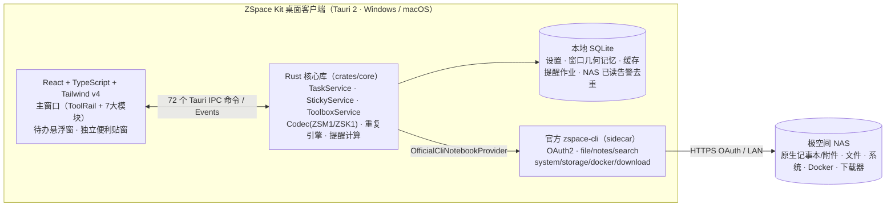

# ZSpace Kit（极空工具箱）

[](https://github.com/garyhj/ZSpaceMemo/actions/workflows/ci-release.yml)
[](LICENSE)

面向极空间 NAS 的跨平台桌面外置工具箱（Windows / macOS，原项目名 **ZSpace Memo**）。

零服务端部署、无需存储 NAS 账号密码——通过官方 OAuth2 授权安全连接你的极空间 NAS，将**极空间待办与重复任务、月历视图、云便签便利贴、文件快传箱、NAS 状态与消息看板、Docker 容器管理、NAS 下载器看板**整合到一个轻量的桌面客户端与系统托盘中。

---

## 核心特性

### 1. 极空工具箱七大模块（`Alt + 1 ~ 7` / macOS `Option + 1 ~ 7`）

- **待办（`Alt + 1`）**
  - 基于**极空间原生独立记事本（`location="2"`）**：一条普通任务或一个重复系列只对应 `ZSpace Memo` 分类下的一条原生笔记。
  - 笔记正文采用「中文可读摘要 + 用户备注 + 末尾 `<p>ZSM1:{...}</p>` 数据块」三段结构，支持在极空间官方客户端中直接查看、修改备注并安全回读（详见 [COMPATIBILITY.md](docs/COMPATIBILITY.md)）。
  - 支持 ETag 乐观并发冲突检测与元数据损坏自动恢复（保留用户在官方 App 修改的新备注）。
  - 7 个视图：今天（含逾期置顶）、即将到来（按天分组）、收集箱、已逾期、全部任务、已完成、重复任务；支持清单分类、多标签、优先级、置顶、全文搜索、清单拖拽归类、右键菜单与撤销 Toast。
  - **待办附件**：复用官方 `file notes` `attachment_upload` / `attachment_download` 接口直接为待办上传多份本地附件、保存下载与移除，附件清单写入 `ZSM1` 并在笔记摘要行展示。
  - **完整重复引擎**：区分「系列」与「发生实例」，支持每天、中国法定工作日（含调休补班）、周一至周五、每周多选、每月/每年公历与 1901–2099 离线农历（含闰月策略与大小月处理）、每月第 N 个周几、每 N 周期（如每半年）、不存在日期顺延或跳过、幂等完成/跳过/撤销及单实例可视化改期/恢复。
- **月视图（`Alt + 2`）**
  - 集成公历与农历 / 节气 / 法定节假日与调休标记，直接投射重复任务的未来发生实例。
  - 支持按清单配色区分胶囊、单日 `+N` 溢出浮层、拖拽改期、右键空白日期格内联快速新建任务。
- **便签（`Alt + 3`）**
  - 同步到极空间原生独立记事本的 `ZSpace Sticky` 专用分类（正文采用 `<p>ZSK1:{...}</p>` 结构），官方客户端同样可见。
  - 支持 6 种便签色卡、置顶、800ms 防抖自动保存，并可将任意便签弹出为**独立桌面置顶便利贴窗口**。
- **文件快传箱（`Alt + 4`）**
  - 目录**严格锁定至极空间「个人空间 / 我的文件/downloads」**（自动探测或初始化创建，不切换其他目录），支持直接从桌面/资源管理器**拖拽本地文件或整个文件夹**（自动按相对路径创建子目录并递归上传）或批量选择上传。
  - 支持统一上传/下载队列（实时进度、失败重试）、多选批量下载到本地目录、列表分页加载以及关键词搜索 `downloads` 目录内文件。
- **NAS 状态看板与消息（`Alt + 5`）**
  - 实时展示 NAS 硬件概览、CPU 负载、内存占用、风扇转速/核心温度、磁盘温度与存储池容量使用情况（兼容 Z4 等机型 `detail.list` 与 `polling` 结构）；原始 JSON 支持选中文本与一键复制。
  - 对接极空间 `system events` 消息通知流（默认展示「通知」），支持筛选、单条已读、全部已读；**自动将新产生的 NAS 告警桥接弹出为 Windows / macOS 系统原生通知**（SQLite 去重，首次启动静默建档不刷屏）。
- **Docker 看板（`Alt + 6`）**
  - 展示 NAS 上所有 Docker 容器运行状态与实时 CPU/内存占用。
  - 支持启动、停止、重启容器及查看/复制最近 100 行容器日志。
- **NAS 下载器看板（`Alt + 7`）**
  - 聚合官方 `zspace-cli download control` / `download tasks` / `download manage`，支持按进行中/已完成筛选、关键词搜索、上下行速率与进度展示及可选 5 秒自动刷新。
  - 支持单任务继续、暂停、删除与新建远程下载链接（自动读取 NAS 默认下载目录配置）。

### 2. 桌面原生体验

- **官方 OAuth2 授权与 LAN 内网直连，零服务端部署**：内置官方 `zspace-nas-agent-toolkit`（`zspace-cli` v0.3.11），应用内一键发起浏览器授权，全程不接触、不保存 NAS 账号密码；支持切换**自动 / 云代理 / LAN 内网直连（`--mode lan --host`）**并内置 `doctor` 连接诊断与超时保护。
- **待办悬浮窄窗**：全局快捷键 `Ctrl+Shift+M` / `Cmd+Shift+M` 随时呼出并聚焦快速输入框（支持自然语言如 `明天 18:00 续费 eSIM !高 #个人`）；展示全部待办并按「已逾期 / 今天 / 本周 / 以后 / 无日期」分组；拖到屏幕边缘自动收起为书签后，**鼠标指向即贴边展开、移开自动折叠，按住顶栏拖离边缘或点「移开固定」即可常驻保留**，且窗口位置与停靠状态跨重启持久保存。
- **系统原生通知与补提醒**：依托本地后台调度器，按时触发 Windows / macOS 系统通知（Windows 自动注册应用 AUMID 保障通知直达；支持多提醒、全天固定时刻、提示音开关）；关机或休眠错过的任务提醒会在下次启动后自动补发通知。
- **桌面端细节打磨与真·应用内更新**：支持关闭隐藏到托盘（托盘右键支持「立即同步」与工作区直达，Tooltip 动态显示待办计数）、开机自启、单实例保护、脱敏滚动诊断日志、主窗/便利贴位置尺寸记忆，以及**应用内一键更新（下载进度条 + SHA-256 校验 + Windows/macOS 自动安装重启）**。

---

## 整体架构



---

## 安装与使用

### 1. 下载安装包

前往 [GitHub Releases](https://github.com/garyhj/ZSpaceMemo/releases) 下载对应平台最新安装包：

- **Windows (x64)**：`ZSpace.Kit_<version>_x64-setup.exe`（NSIS）或 `ZSpace.Kit_<version>_x64_en-US.msi`
- **macOS (Apple Silicon)**：`ZSpace.Kit_<version>_aarch64.dmg`

> 当前版本未配置商业代码签名：
> - Windows 首次运行若弹出 SmartScreen，点「更多信息 → 仍要运行」；从旧版 `v0.2.x` 升级后若任务栏仍显示旧固定图标缓存，在任务栏右键「从任务栏取消固定」再重新固定一次即可刷新。
> - macOS 首次打开请右键应用选「打开」，或在终端执行 `xattr -cr "/Applications/ZSpace Kit.app"`。

### 2. 首次授权

1. 打开 ZSpace Kit，点击「发起极空间官方授权」。
2. 在弹出的浏览器页面中同意授权，复制一次性授权码粘贴回应用。
3. 应用会自动在极空间独立记事本中检查并创建 `ZSpace Memo`（待办）和 `ZSpace Sticky`（便签）专用分类。

### 3. 快捷键一览

| 快捷键 | 作用 |
|---|---|
| `Ctrl / Cmd + Shift + M` | 全局呼出 / 隐藏待办悬浮窗并聚焦快速输入框 |
| `Alt / Option + 1 ~ 7` | 切换工作区：待办 / 月视图 / 便签 / 快传箱 / NAS 状态 / Docker / 下载器 |
| `Ctrl / Cmd + K` 或 `/` | 聚焦任务搜索框 |
| `N` | 聚焦快速新建任务输入框 |
| `↑ / ↓` | 在任务列表中上下切换选中项 |
| `Space` 或 `Ctrl / Cmd + Enter` | 完成 / 重新打开选中任务 |
| `Delete` | 删除选中任务 |
| `1 / 2 / 3 / 4` | 在待办视图间切换：今天 / 即将到来 / 收集箱 / 全部 |
| `Esc` | 关闭弹窗、右键菜单或取消选中 |

在快速输入框中按 `Enter` 直接创建任务，支持轻量自然语言语法：`今天/明天/后天/下周一`、`18:00`、`!高/!紧急/!低`、`#清单名`。

---

## 目录结构

采用 **Tauri 2 + Rust Workspace** 布局，核心业务逻辑下沉到零 GUI 依赖的 `crates/core` 中：

```text
ZSpaceMemo/
├── .github/workflows/
│   └── ci-release.yml          # CI 核心单测、前端构建及 Windows/macOS 双端自动打包发布
├── crates/
│   └── core/                   # 纯 Rust 核心引擎（零 GUI 依赖，可独立 cargo test）
│       ├── src/
│       │   ├── models.rs       # Task / Schedule / Reminder / RepeatRule / Series 模型
│       │   ├── codec.rs        # <p>ZSM1:{...}</p> 双向编解码、实体归一化、富文本保护
│       │   ├── recurrence.rs   # 纯函数重复规则引擎（系列 → 发生实例）
│       │   ├── lunar.rs        # 离线中国农历换算（1901–2099）与法定工作日判断
│       │   ├── lunar_tables.rs # 农历年表与 2001–2027 国务院法定调休节假日查找表
│       │   ├── reminder.rs     # 纯函数提醒触发计算（IANA 时区 & 夏令时安全）
│       │   ├── sticky.rs       # 云便签服务与 <p>ZSK1:{...}</p> 编解码（ZSpace Sticky）
│       │   ├── toolbox.rs      # ToolboxService（快传箱、NAS 状态/事件、Docker、下载器看板）
│       │   ├── storage.rs      # 本地 SQLite（设置、任务/便签缓存、提醒作业、NAS 告警去重）
│       │   ├── service.rs      # TaskService（增量同步、附件、ETag 冲突、自动恢复、7 视图）
│       │   ├── error.rs        # 结构化错误码
│       │   └── provider/
│       │       ├── mod.rs          # NotebookProvider 抽象 trait
│       │       ├── official_cli.rs # 官方 zspace-cli v0.3.11 封装、OAuth2 与通用 run_cli
│       │       └── mock.rs         # 内存 MockProvider（用于自动化测试）
│       └── tests/
│           └── live_nas_smoke.rs   # 真实 NAS 只读冒烟测试（默认 ignored）
├── src/                        # React 19 + TypeScript + Tailwind v4 前端
│   ├── App.tsx                 # 多窗体模式路由（主窗 / 悬浮待办 / 便利贴）与全局交互
│   ├── api.ts                  # Tauri IPC 类型化封装
│   ├── types.ts                # 前后端对齐的 DTO 类型定义
│   ├── modules/                # 工具箱扩展模块
│   │   ├── registry.tsx        # 模块注册表（Alt/Option + 1~7）
│   │   ├── sticky/             # 云便签面板、色卡配置与独立悬浮便利贴窗
│   │   ├── files/              # 文件快传箱（拖拽上传 / 浏览 / 搜索 / 下载）
│   │   ├── nas/                # NAS 硬件状态看板与消息中心
│   │   ├── docker/             # Docker 容器监控、启停与日志查看
│   │   └── downloader/         # NAS 下载器任务监控、控制与新建下载
│   ├── components/             # 待办业务组件（Auth / MonthCalendar / Floating / Detail / Settings 等）
│   └── utils/                  # 日期自然语言解析、农历节假日、UI 偏好设置、应用内更新桥接
├── src-tauri/                  # Tauri 2 桌面壳（Windows / macOS）
│   ├── src/
│   │   ├── main.rs             # 入口
│   │   ├── logging.rs          # 2 MiB 脱敏滚动文件日志（Token/密码自动擦除）
│   │   ├── updater.rs          # 应用内更新：流式下载、SHA-256 校验、自动覆盖安装与重启
│   │   ├── lib.rs              # 72 个 IPC 命令、托盘、快捷键、窗口几何记忆、贴边展开、AUMID
│   │   └── scheduler.rs        # 后台同步、15 秒原生提醒调度与 NAS 告警桥接循环
│   ├── capabilities/           # Tauri 2 权限声明（notification / dialog / sticky-* 等）
│   ├── icons/                  # ZSpace Kit 跨平台应用与托盘图标（.ico / .icns / PNG）
│   ├── binaries/               # 构建时下载的官方 zspace-cli sidecar（不提交到 Git）
│   └── tauri.conf.json         # 窗口、托盘、bundle 与插件配置
├── scripts/
│   └── fetch-sidecar.sh        # 本地开发一键下载并校验官方 zspace-cli 二进制
├── docs/                       # 设计、兼容验证、原型与需求归档
│   ├── DESIGN.md               # 产品与技术设计（v0.7）
│   ├── COMPATIBILITY.md        # M0 真机兼容性与 CLI 实测适配记录
│   ├── prototype/index.html    # 早期待办交互原型（单文件 HTML）
│   └── requirements/           # 原始调研与需求文档归档
├── CHANGELOG.md                # 版本更新记录
├── Cargo.toml                  # Rust Workspace（crates/core）
├── package.json                # 前端依赖与脚本
└── LICENSE                     # MIT License
```

---

## 本地开发与测试

### 前置依赖

- Rust（stable）
- Node.js 22+ 与 pnpm 10+
- Tauri 2 平台构建依赖（参考 [Tauri Prerequisites](https://v2.tauri.app/start/prerequisites/)）

### 常用命令

```bash
# 1. 安装前端依赖
pnpm install

# 2. 运行 Rust 核心单元测试（无需桌面 GUI 依赖，无需连接 NAS）
cargo test -p zspace-memo-core

# 3. 校验前端 TypeScript 与 Vite 构建
pnpm build

# 4. 下载并校验本机对应的官方 zspace-cli sidecar
chmod +x scripts/fetch-sidecar.sh
./scripts/fetch-sidecar.sh

# 5. 启动 Tauri 桌面开发模式
pnpm tauri dev

# 6. （可选）使用已登录的本地 zspace-cli profile 跑真实 NAS 只读冒烟测试
ZSPACE_CLI_BIN=/path/to/zspace-cli ZSPACE_CLI_HOME=/path/to/cli-home \
  cargo test -p zspace-memo-core --test live_nas_smoke -- --ignored --nocapture
```

---

## 路线图

- [x] **M0**：官方 `zspace-cli` OAuth2 与真实极空间 NAS / Windows 客户端兼容性验证（[COMPATIBILITY.md](docs/COMPATIBILITY.md)）
- [x] **M1**：Rust 核心引擎（Codec、重复引擎、提醒计算、SQLite 缓存、`OfficialCliNotebookProvider`）与 Tauri 2 骨架
- [x] **M2 / M3**：完整三栏主界面、悬浮待办窗（全部分组与贴边隐藏）、月视图（农历/节假日/拖拽改期）、系统原生通知提醒、Windows/macOS 双端自动发布
- [x] **v0.3.0 ~ v0.4.3**：工具箱成型、云便签、`Z4` 状态解析与可复制日志、窗口几何与贴边记忆、脱敏滚动日志、Windows AUMID 通知与流式校验应用内更新
- [x] **v0.5.0**：极空间 LAN 内网直连与 `doctor` 连接诊断、文件快传箱文件夹递归上传、统一上传/下载队列与重试、批量下载与分页加载
- [x] **v0.6.0**：重复引擎支持中国法定工作日/调休（`cn_workday`）、离线 1901–2099 农历重复与闰月策略、单次发生实例可视化改期与恢复
- [x] **v0.7.0**：待办原生附件上传/下载/关联（`file notes` `attachment_upload` / `attachment_download`）与 NAS 下载器看板（`Alt + 7`）
- [x] **v0.7.1**：滴答清单风格任务左侧栏重构（4 项核心视图 + 底部工具区、清单/标签可折叠、颜色圆点右移、一键收起侧边栏、逾期一键顺延）
- [x] **v0.7.2**：核心底座加固与体验稳定性优化（`ZSM1` HTML 转义与兼容保留、同步互斥锁、僵尸提醒与调度解耦、更新 SHA-256 强制校验与 macOS 备份回滚、自启/退出对齐、详情/便签防丢草稿队列、自定义清单持久化，以及 `React.lazy` + 农历分包首屏体积大幅瘦身）
- [ ] **后续扩展**：文件分享与标签快捷管理、Docker 镜像与 Compose 看板、存储池 SMART / 备份中心只读巡检

---

## 文档导航

- [产品与技术设计（v0.7）](docs/DESIGN.md)
- [版本变更记录（CHANGELOG）](CHANGELOG.md)
- [M0 真机兼容性验证与 CLI 适配记录](docs/COMPATIBILITY.md)
- [早期交互原型（单文件 HTML）](docs/prototype/index.html)
- 原始需求归档：[01-initial.md](docs/requirements/01-initial.md) · [02-todo-extension.md](docs/requirements/02-todo-extension.md) · [03-architecture-notes.md](docs/requirements/03-architecture-notes.md)

## 致谢与许可

- 本项目通过官方 `zspace-nas-agent-toolkit`（`zspace-cli`）与极空间 NAS 通信；前期协议调研参考了 [coracoo/zspace_skill](https://github.com/coracoo/zspace_skill) 与 [skyzhao1223/zspace-cli](https://github.com/skyzhao1223/zspace-cli)。
- 本项目源代码采用 [MIT License](LICENSE) 开源。
