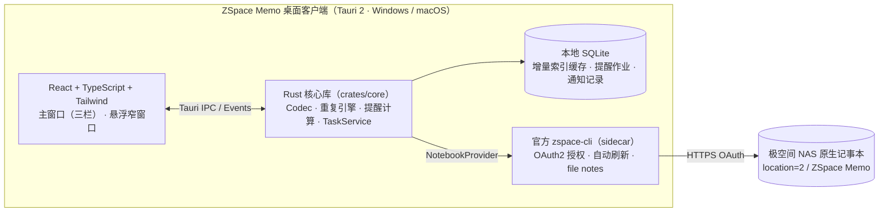

# ZSpace Memo

[](https://github.com/garyhj/ZSpaceMemo/actions/workflows/ci-release.yml)
[](LICENSE)

基于**极空间 NAS 原生独立记事本（`location="2"`）**的跨平台桌面 Todo 与任务管理工具（Windows / macOS）。

零服务端部署、无需存储 NAS 账号密码——通过官方 OAuth2 授权直接读写极空间原生笔记，让你在桌面拥有完整日程/重复任务/悬浮快捷窗体验的同时，所有数据依然可以在极空间官方记事本中原生查看和编辑。

---

## 核心特性

- **原生数据互通，唯一事实来源**
  - 一条普通任务对应极空间独立记事本中的一条原生笔记；一个重复系列也只对应一条原生笔记，统一归属专用分类 `ZSpace Memo`。
  - 笔记正文采用「中文可读摘要 + 用户备注 + 末尾 `<p>ZSM1:{...}</p>` 数据块」结构，已通过真实极空间 NAS 与 Windows 官方客户端往返编辑验证（见 [COMPATIBILITY.md](docs/COMPATIBILITY.md)）。
  - 支持 ETag 乐观并发冲突检测与元数据损坏自动恢复（恢复提醒/重复规则的同时保留用户在官方 App 中修改的新备注）。
- **官方 OAuth2 授权，零服务端部署**
  - 内置官方 `zspace-nas-agent-toolkit`（`zspace-cli` v0.3.11），应用内一键发起浏览器授权，全程不接触、不保存 NAS 账号密码，access token 自动刷新。
- **完整任务管理与重复引擎**
  - 7 个核心视图：收集箱、今天（含逾期分组）、即将到来（按天分组）、已逾期、全部任务、已完成、重复任务；支持全文搜索、清单、多标签、优先级、置顶。
  - 重复任务严格区分「系列」与「发生实例」：支持每天、工作日、每周多选、每月指定日/最后一天/第 N 个周几、每年、每 N 周期（如每半年）、不存在日期顺延或跳过、逾期策略、幂等完成/跳过/撤销、实时预览接下来 5 次发生日期。
- **桌面原生体验与本地常驻提醒**
  - **两层窗口**：完整三栏主窗口 + 置顶悬浮窄窗口（全局快捷键 `Ctrl+Shift+M` / `Cmd+Shift+M` 随时呼出并自动聚焦快速输入框，支持自然语言如 `明天 18:00 续费 eSIM !高 #个人`）。
  - **常驻托盘 + 开机自启**：支持多提醒（提前分钟/小时/天、全天固定时刻），后台定时增量同步与 OS 原生通知，关机期间错过的提醒在下次开机时自动补提醒并记入应用内通知中心。

---

## 整体架构



---

## 安装与使用

### 1. 下载安装包

前往 [GitHub Releases](https://github.com/garyhj/ZSpaceMemo/releases) 下载对应平台安装包：

- **Windows (x64)**：`.exe`（NSIS）或 `.msi`
- **macOS (Apple Silicon)**：`.dmg`

> 当前版本未配置商业代码签名：
> - Windows 首次运行若弹出 SmartScreen，点「更多信息 → 仍要运行」；
> - macOS 首次打开请右键应用选「打开」，或在终端执行 `xattr -cr "/Applications/ZSpace Memo.app"`。

### 2. 首次授权

1. 打开 ZSpace Memo，点击「发起极空间官方授权」。
2. 在弹出的浏览器页面中同意授权，复制一次性授权码粘贴回应用。
3. 应用会自动在极空间独立记事本中检查并创建 `ZSpace Memo` 专用分类。

### 3. 常用快捷键

- `Ctrl + Shift + M`（macOS：`Cmd + Shift + M`）：全局呼出 / 隐藏置顶悬浮快捷窗。
- 在快速输入框中按 `Enter` 直接创建任务，支持轻量语法：`今天/明天/后天/下周一`、`18:00`、`!高/!紧急/!低`、`#清单名`。

---

## 目录结构

采用标准的 **Tauri 2 + Rust Workspace** 布局，核心业务逻辑完全下沉到零 GUI 依赖的 `crates/core` 中，便于独立单测与未来扩展：

```text
ZSpaceMemo/
├── .github/workflows/
│   └── ci-release.yml          # CI 单测、前端构建及 Windows/macOS 双端自动打包
├── crates/
│   └── core/                   # 纯 Rust 核心引擎（无 GUI 依赖，可独立 cargo test）
│       ├── src/
│       │   ├── models.rs       # Task / Schedule / Reminder / RepeatRule / Series 模型
│       │   ├── codec.rs        # <p>ZSM1:{...}</p> 双向编解码、实体归一化、富文本保护
│       │   ├── recurrence.rs   # 纯函数重复规则引擎（系列 → 发生实例）
│       │   ├── reminder.rs     # 纯函数提醒触发计算（IANA 时区 & 夏令时安全）
│       │   ├── storage.rs      # 本地 SQLite（设置、可重建索引缓存、提醒作业、通知）
│       │   ├── service.rs      # TaskService（增量同步、ETag 冲突、自动恢复、7 视图）
│       │   ├── error.rs        # 结构化错误码
│       │   └── provider/
│       │       ├── mod.rs          # NotebookProvider 抽象 trait
│       │       ├── official_cli.rs # 官方 zspace-cli v0.3.11 封装与 OAuth2 交互
│       │       └── mock.rs         # 内存 MockProvider（用于自动化测试）
│       └── tests/
│           └── live_nas_smoke.rs   # 真实 NAS 只读冒烟测试（默认 ignored）
├── src/                        # React 19 + TypeScript + Tailwind v4 前端
│   ├── App.tsx                 # 主窗口三栏布局 & 模式路由（主窗 / 悬浮窗）
│   ├── api.ts                  # Tauri IPC 类型化封装
│   ├── types.ts                # 前后端对齐的 DTO 类型定义
│   ├── utils/date.ts           # 日期格式化、逾期判断、快捷输入解析
│   └── components/             # 业务组件（Auth / QuickAdd / DatePicker / Reminder / Repeat / Detail / Floating / Settings / Notifications）
├── src-tauri/                  # Tauri 2 桌面壳（Windows / macOS）
│   ├── src/
│   │   ├── main.rs             # 入口
│   │   ├── lib.rs              # 25 个 IPC 命令、托盘、全局快捷键、开机自启、关闭到托盘
│   │   └── scheduler.rs        # 后台定时同步、15 秒提醒触发与开机补提醒循环
│   ├── capabilities/           # Tauri 2 权限声明
│   ├── icons/                  # 跨平台应用图标（.ico / .icns / PNG）
│   ├── binaries/               # 构建时下载的官方 zspace-cli sidecar（不提交到 Git）
│   └── tauri.conf.json         # 窗口、托盘与打包配置
├── scripts/
│   └── fetch-sidecar.sh        # 本地开发一键下载并校验官方 zspace-cli 二进制
├── docs/                       # 设计、兼容验证、原型与需求归档
│   ├── DESIGN.md               # 产品与技术设计（v0.2）
│   ├── COMPATIBILITY.md        # M0 真实 NAS + Windows 客户端兼容性验证记录
│   ├── prototype/index.html    # 可交互静态原型（浏览器直接打开）
│   └── requirements/           # 原始调研与需求文档归档
├── Cargo.toml                  # Rust Workspace（crates/core）
├── package.json                # 前端依赖与脚本
└── LICENSE                     # MIT License
```

---

## 本地开发与测试

### 前置依赖

- Rust（stable）
- Node.js 22+ 与 pnpm 10+
- Tauri 2 平台构建依赖（参考 [Tauri Prerequisites](https://v2.tauri.app/start/prerequisites/)）

### 常用命令

```bash
# 1. 安装前端依赖
pnpm install

# 2. 运行 Rust 核心单元测试（无需桌面 GUI 依赖，无需连接 NAS）
cargo test -p zspace-memo-core

# 3. 校验前端 TypeScript 与 Vite 构建
pnpm build

# 4. 下载并校验本机对应的官方 zspace-cli sidecar
chmod +x scripts/fetch-sidecar.sh
./scripts/fetch-sidecar.sh

# 5. 启动 Tauri 桌面开发模式
pnpm tauri dev

# 6. （可选）使用已登录的本地 zspace-cli profile 跑真实 NAS 只读冒烟测试
ZSPACE_CLI_BIN=/path/to/zspace-cli ZSPACE_CLI_HOME=/path/to/cli-home \
  cargo test -p zspace-memo-core --test live_nas_smoke -- --ignored --nocapture
```

---

## 路线图

- [x] **M0**：官方 `zspace-cli` OAuth2 与真实极空间 NAS / Windows 客户端兼容性验证（[COMPATIBILITY.md](docs/COMPATIBILITY.md)）
- [x] **M1**：Rust 核心引擎（Codec、重复引擎、提醒计算、SQLite 缓存、`OfficialCliNotebookProvider`）与 Tauri 2 骨架
- [x] **M2**：完整三栏主界面、悬浮窄窗口、日期/多提醒/重复编辑器、通知中心、设置与 Windows/macOS 双端打包
- [ ] **M3 / P2**：中国法定工作日/节假日调休、农历重复、单次实例覆盖编辑（修改本次 / 本次及以后）、更多本地化体验打磨
- [ ] **P3**：子任务、附件（复用官方 `file notes` 附件接口）、导出 TXT/DOCX、日历视图

---

## 文档导航

- [产品与技术设计（v0.2）](docs/DESIGN.md)
- [M0 真机兼容性验证记录](docs/COMPATIBILITY.md)
- [交互原型（单文件 HTML）](docs/prototype/index.html)
- 原始需求归档：[01-initial.md](docs/requirements/01-initial.md) · [02-todo-extension.md](docs/requirements/02-todo-extension.md) · [03-architecture-notes.md](docs/requirements/03-architecture-notes.md)

## 致谢与许可

- 本项目通过官方 `zspace-nas-agent-toolkit`（`zspace-cli`）与极空间 NAS 通信；前期协议调研参考了 [coracoo/zspace_skill](https://github.com/coracoo/zspace_skill) 与 [skyzhao1223/zspace-cli](https://github.com/skyzhao1223/zspace-cli)。
- 本项目源代码采用 [MIT License](LICENSE) 开源。
