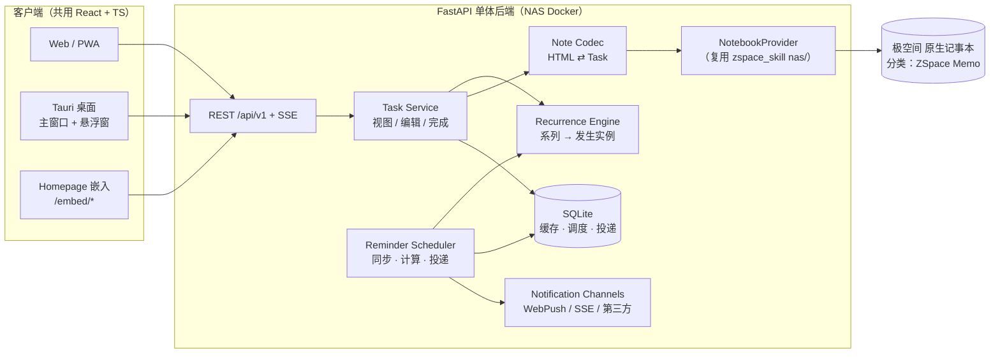
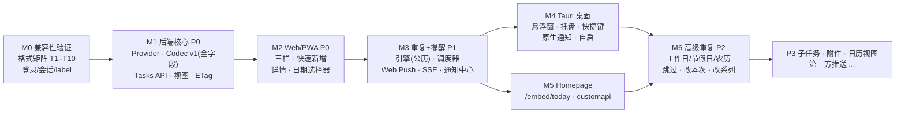

# ZSpace Memo 产品与技术设计（v0.1 草案）

> 状态：**设计评审中，尚未进入编码**。
> 输入：[`requirements/01-initial.md`](requirements/01-initial.md)（v1.0 调研文档）、[`requirements/02-todo-extension.md`](requirements/02-todo-extension.md)（Todo 扩展需求）、[`requirements/03-architecture-notes.md`](requirements/03-architecture-notes.md)（三条架构建议）。
> 本文档带 `【待确认】` 的地方需要产品负责人决定；带 `【M0 验证】` 的地方必须先在真实 NAS 上验证，才能定稿。

本项目真正的难点有三个，本设计围绕它们展开：

1. **原生笔记兼容性**：结构化数据要写进普通 HTML 笔记里，官方记事本能正常看、正常改，改完之后不能丢数据。
2. **重复任务引擎**：要区分"系列"和"发生实例"，一条系列只对应一条笔记，并且保留完成历史。
3. **跨设备提醒**：由 NAS 后端独立调度，电脑关机也能按时触发；各个客户端只负责接收和展示通知。

---

## 0. 已确认的决策

| # | 决策 | 来源 |
|---|---|---|
| D1 | 一条普通任务对应一条原生笔记；一个重复**系列**也只对应一条原生笔记，每次的发生实例记录在这条笔记里 | 需求 02 / 建议 2 |
| D2 | 独立记事本 `location=2`；专用分类默认名为 `ZSpace Memo`（可在设置里改，后端按分类 ID 识别） | 需求 02 |
| D3 | 提醒调度由 NAS 上的 FastAPI 后端负责，不依赖桌面客户端 | 需求 02 / 建议 1 |
| D4 | 笔记正文分三段：**人类可读摘要** + **用户备注** + **结构化数据块**；不使用 HTML 注释、隐藏标签、自定义属性来存数据 | 建议 3 |
| D5 | 元数据在官方记事本里显示中文，解析器中英文都认 | Q&A |
| D6 | 桌面悬浮窄窗口 = 精简 Todo 列表 + 快速新增；完整编辑在主界面完成 | Q&A |
| D7 | Web 用管理员密码登录换 HttpOnly Cookie；桌面端和 Homepage 用可撤销的 API Token | Q&A |
| D8 | 后端部署在极空间自带的 Docker 里 | Q&A |
| D9 | Homepage 指 gethomepage/homepage，用 iframe 嵌入，或用 customapi 组件调接口 | Q&A |
| D10 | M0 验证阶段，开发虚拟机通过 Tailscale 直连 NAS | Q&A |
| D11 | 可以有辅助 SQLite，但只存配置、提醒调度、推送订阅、发送记录和**可重建的缓存**，不存第二份任务数据 | 需求 02 |

---

## 1. 功能结构



### 1.1 功能清单与优先级

| 模块 | 功能 | 优先级 |
|---|---|---|
| 任务基础 | 新增 / 编辑 / 删除 / 完成 / 重新打开；标题、备注（多行 + 链接 + 基础 Markdown） | P0 |
| 任务属性 | 优先级、分类（清单）、多标签、置顶 | P0 |
| 时间 | 开始日期/时间、截止日期/时间、全天、时间段 | P0 |
| 视图 | 收集箱、今天、即将到来、已逾期、全部、已完成；排序、搜索 | P0 |
| 视图 | 重复任务视图 | P1 |
| 提醒 | 准时 / 提前 N / 自定义 / 多个提醒；NAS 后端调度 | P1 |
| 通知渠道 | Web Push（浏览器 + PWA）、Tauri 原生通知（SSE）、应用内通知中心 | P1 |
| 重复 | 每天 / 每周（选星期几）/ 每月（日期、最后一天、第 N 个星期几）/ 每年 / 每 N 天·周·月（含每半年）；完成本次后自动推进到下一次 | P1 |
| 重复 | 工作日（中国法定调休）、节假日、农历、跳过本次、修改本次、修改系列、终止系列、历史管理 | P2 |
| 扩展 | 子任务、附件、更完整的 Markdown、邮件和其他推送、日历视图、Homepage 深度集成 | P3 |

> [!IMPORTANT]
> **数据结构和接口从第一版起就按完整模型设计**。P0 阶段 codec 就要能完整读写 `repeat`、`reminders`、`series` 这些字段，并原样保留认不出的字段，这样后面加功能不需要迁移数据格式。

---

## 2. 核心概念

| 概念 | 定义 |
|---|---|
| **Task（任务）** | 一条原生笔记，`id` 就是原生笔记 ID。分两种：**单次任务**（没有 `repeat`）和**重复系列**（有 `repeat`） |
| **Series（系列）** | 带重复规则的任务，定义了"模板"（标题、备注、时间形状、提醒、优先级）和规则 |
| **Occurrence（发生实例）** | 系列在某个日期的一次具体执行，用**原始日期** `occurrence_key = YYYY-MM-DD` 唯一标识（相当于 iCalendar 的 RECURRENCE-ID） |
| **Schedule（时间安排）** | 开始、结束、截止、全天、时区。和提醒、重复是相互独立的字段 |
| **Reminder（提醒规则）** | 相对某个锚点（开始 / 截止）提前多久，或者一个绝对时间。一个任务可以有多个 |
| **Reminder Job（提醒作业）** | 调度器从规则计算出的"在某个 UTC 时刻给某个实例发提醒"，存在 SQLite 里，**可以随时重建** |
| **List（清单 / 分类）** | 任务的业务分类，例如"工作""生活"。和极空间的原生分类不是一回事（见 3.7） |

系列和实例的关系，用需求里"每半年续费 eSIM"的例子：

```text
系列 #12345「续费 eSIM」 repeat = 每 6 个月，锚定 24 日
├── 2026-11-24  completed   完成于 2026-11-24 20:13
├── 2027-05-24  pending     ← 当前实例（cursor），提醒会针对它触发
└── 2027-11-24  future      由规则推算得到，不存储
```

---

## 3. 任务数据模型

下面是 API 层的 JSON 模型（Pydantic / TypeScript 共用一份定义）。存进笔记时的形式见第 4 节。

### 3.1 Task

```jsonc
{
  "id": 12345,                       // 原生笔记 ID，不另造 ID
  "title": "续费 eSIM",               // = 原生 title
  "description": "记录充值金额、运营商和[续费链接](https://...)。", // Markdown 子集
  "status": "pending",               // 单次：pending | completed；系列：active | ended
  "priority": "normal",              // low | normal | high | urgent
  "list": "个人",                     // 清单 / 分类，可以为空（为空时显示为"未分类"）
  "labels": ["续费", "eSIM"],
  "pinned": false,                   // = 原生 pin_flag
  "schedule": { /* 3.2 */ },
  "reminders": [ /* 3.3 */ ],
  "repeat": null,                    // 或 RepeatRule（第 5 节）
  "series": null,                    // 重复任务的实例状态（3.5）
  "completed_at": null,              // 单次任务的完成时间
  "created_at": "2026-11-24T10:00:00+08:00", // 优先用原生字段；拿不到就返回 null，不编造
  "updated_at": "2026-11-24T10:00:00+08:00",
  "source": "zspace_notebook",
  "meta_state": "ok",                // ok | missing（官方新建的笔记）| recovered | conflict
  "etag": "W/\"7-9f2c\""             // rev + 正文哈希，用来做并发控制
}
```

### 3.2 Schedule：开始、结束、截止相互独立

```jsonc
"schedule": {
  "all_day": false,
  "start": { "date": "2026-11-24", "time": null },   // 可选
  "end":   null,                                      // 可选：时间段的结束（见下方说明）
  "due":   { "date": "2026-11-26", "time": "18:00" }, // 可选：截止
  "timezone": "Asia/Shanghai"                         // IANA 时区；all_day 时日期是"浮动"的
}
```

规则：

- `date` 和 `time` 分开存。`time = null` 表示这一端只有日期。`all_day = true` 时，所有 `time` 都必须为空。
- 校验：如果都有值，必须满足 `start ≤ end`、`start ≤ due`。
- **时间段**：`start.time` + `end.time`，例如 25 日 14:00–15:00 处理；**截止** `due` 是另一个概念，例如 26 日 18:00 前必须完成。【待确认 Q2】是否把"时间段的结束"和"截止"合成一个字段。模型里先保留 `end`，便于以后扩展；如果合并，UI 只展示 start/due，`end` 永远为 null。
- **视图使用的"主日期"**：有 `due` 用 `due`，没有 `due` 用 `start`，都没有就进收集箱。

### 3.3 Reminder：提醒和截止相互独立，可以有多个

```jsonc
"reminders": [
  { "id": "r1", "type": "relative", "anchor": "due",   "offset_minutes": -1440 }, // 提前 1 天
  { "id": "r2", "type": "relative", "anchor": "due",   "offset_minutes": -60 },   // 提前 1 小时
  { "id": "r3", "type": "relative", "anchor": "start", "offset_minutes": 0 },     // 开始时
  { "id": "r4", "type": "relative", "anchor": "due",   "offset_days": -1, "day_time": "09:00" }, // 全天任务：前一天 09:00
  { "id": "r5", "type": "absolute", "at": "2026-11-25T18:00" }                     // 只能用于单次任务
]
```

- 预设选项（不提醒 / 准时 / 5、10、15、30 分钟 / 1 小时 / 1 天 / 自定义）只是 UI 的快捷方式，存下来的都是上面这种通用形式。
- 全天任务的"准时"等于当天的 `day_time`（默认 09:00，可以在设置里改）。
- 重复系列**不允许**用 `absolute`；在 UI 上设置的绝对时间，会换算成相对首次实例的偏移量。
- 提醒发到哪些渠道默认跟随全局设置；预留 `channels` 字段，以后可以按单条提醒覆盖（P3）。
- 某个锚点被清空时，例如删掉了截止时间，依赖它的提醒标记为 `inactive`，并在 UI 上提示，不会被静默删除。

### 3.4 Priority / List / Labels

- `priority`：`low | normal | high | urgent`，在笔记里显示为"低 / 普通 / 高 / 紧急"。
- `labels`：**优先存到原生 `label` 字段**，这样官方 App 里也能看到标签。【M0 验证】原生 label 是单个字符串，多个标签用什么分隔、官方 App 怎么显示，需要实测；如果原生字段不可靠，就退回存到数据块里。
- `list`：存在数据块里，见 3.7。

### 3.5 Series（重复任务的实例状态）

```jsonc
"series": {
  "cursor": "2027-05-24",          // 当前待处理实例的原始日期
  "overrides": {                    // "修改本次"：只对未来、尚未处理的实例生效
    "2027-05-24": { "schedule": { "due": { "date": "2027-05-26", "time": "18:00" } } }
  },
  "history": [                      // 用户的显式操作，按时间倒序
    { "key": "2026-11-24", "status": "completed", "at": "2026-11-24T20:13:00+08:00" },
    { "key": "2026-05-24", "status": "skipped",   "at": "2026-05-23T09:00:00+08:00" }
  ],
  "history_summary": { "completed": 0, "skipped": 0, "before": null }, // 历史条数超过上限后压缩成计数
  "ended_at": null                  // 终止系列的时间
}
```

实例有五种状态：`completed`（已完成）、`skipped`（已跳过）、`missed`（错过，**推算得到，不存储**）、`pending`（当前）、`future`（未来，**推算得到，不存储**）。详细逻辑见第 5 节。

### 3.6 字段存放位置

| 字段 | 原生字段 | 正文·可读摘要 | 正文·备注 | 正文·数据块 | SQLite |
|---|---|---|---|---|---|
| id | ✅ `id` | | | | 缓存 |
| title | ✅ `title` + `<h1>` | | | | 缓存 |
| description | | | ✅ | | 缓存 |
| status / priority | | ✅ 显示 | | ✅ 权威 | 缓存 |
| schedule | | ✅ 显示 | | ✅ 权威 | 缓存 |
| reminders / repeat | | ✅ 显示（文字描述） | | ✅ 权威 | 缓存 + 调度作业 |
| series（含历史） | | ✅ 最近几次 | | ✅ 权威 | 缓存 |
| list | | ✅ 显示 | | ✅ 权威 | 缓存 |
| labels | ✅ `label`（待验证） | | | 备选 | 缓存 |
| pinned | ✅ `pin_flag` | | | | 缓存 |
| created/updated | ✅（待验证） | | | | 缓存 |
| 推送订阅、投递记录、稍后提醒 | | | | | ✅ 运行数据，不属于任务数据 |

### 3.7 清单（分类）的存放方式

【待确认 Q5】推荐方案：**清单名存在数据块里**，所有任务都直接放在 `ZSpace Memo` 这一个原生分类下，和需求 02 里的目录结构一致。

- 好处：符合"单层分类、按 ID 查询列表不会漏"的约束；改清单名只需要改数据，不需要移动笔记。
- 代价：在官方 App 里不能按清单浏览，只能在摘要行里看到"清单：工作"。
- 备选：在 `ZSpace Memo` 下建原生子分类，每个子分类就是一个清单，后端遍历分类树查询。官方 App 体验更好，但会引入重命名同步、删除分类、笔记跨分类移动这些额外问题。建议放到 P3 再评估。

---

## 4. 笔记正文存储格式

### 4.1 设计原则

1. **官方记事本里看到的是一条正常、可读的笔记**：标题、一两行中文摘要、用户备注、最后是一段明确标注"请勿编辑"的数据块。
2. **结构化数据只有一个权威来源，就是数据块**。摘要是根据数据块生成的展示内容，同时支持有限的反向解析（见 4.4）。
3. **不依赖**任何可能被官方编辑器丢掉的东西：HTML 注释、`data-*` 属性、`class`、`style`、`display:none`、`<script>`。可以输出 `class` 作为辅助定位，但解析时不能依赖它。
4. 用户备注区域放在中间，用户在官方 App 里自然编辑时，最可能改动的就是这一段；数据块放在**最后**，离用户的编辑位置最远。

### 4.2 正文结构（暂定格式，最终形式由 M0 验证决定）

```html
<h1>续费 eSIM</h1>
<p>📅 截止 2026-11-26 周四 18:00 · 开始 2026-11-24</p>
<p>🔁 每 6 个月 · ⏰ 提前 1 天、提前 1 小时 · 优先级：普通 · 清单：个人</p>
<p>状态：待办 · 本次 2027-05-24 · 上次完成 2026-11-24</p>
<hr>
<p>记录充值金额、运营商和<a href="https://...">续费链接</a>。</p>
<hr>
<p>⚙ ZSpace Memo 数据（由 ZSpace Memo 自动维护，请勿手动修改）</p>
<pre>ZSM1:{"v":1,"rev":7,"status":"active","priority":"normal","list":"个人","schedule":{...},"reminders":[...],"repeat":{...},"series":{...},"sum":"9f2c..."}</pre>
```

- 第一行必须是 `<h1>{title}</h1>`（zspace_skill 实测：不加这一行 NAS 不保存正文）。
- **摘要行**放在 h1 后面，所以官方列表里显示的 `in_brief`（正文前 100 字）正好就是"截止…重复…"这类关键信息。
- **数据块**用 `ZSM1:` 作为前缀，后面跟紧凑 JSON。`sum` 是"摘要行渲染结果"的哈希，用来检测用户是否在官方 App 里改过摘要（见 4.4）。
- 数据块的编码方式按 M0 验证结果，按下面的顺序选一个：
  1. `<pre>` 里放 JSON（可读性最好，前提是官方编辑器不改写其中的引号和空白；解析时会先做 HTML 反转义）；
  2. `<p>` 里放 JSON（`<pre>` 被转换成普通段落时使用）；
  3. `<p>` 里放 `ZSM1b:` 加 base64url（JSON 被编辑器破坏时使用，抗重排能力最强，但人读不懂；摘要行仍然保证官方 App 里的可读性）。

### 4.3 【M0 验证】兼容性测试矩阵

每一种候选格式都要在真实 NAS 上跑完以下操作，并记录到 `docs/COMPATIBILITY.md`：

| # | 操作 | 观察点 |
|---|---|---|
| T1 | API 新建 → 官方 Web / Windows / macOS / 手机 App 打开查看 | 是否正常显示？数据块是否可见、是否被折叠？`in_brief` 是什么？ |
| T2 | 在官方 App 里**只改备注**并保存 → API 读回 | 数据块是否逐字节保留？`<pre>`、引号、换行、emoji 有没有被改写？ |
| T3 | 在官方 App 里改标题 | `title` 和 `<h1>` 是否同步？ |
| T4 | 在官方 App 里修改摘要行（例如把截止日期改掉） | 能否被检测到？ |
| T5 | 在官方 App 里误删数据块的一部分或全部 | 恢复流程是否生效（4.5） |
| T6 | 在官方 App 里新建一条笔记放进该分类 | 是否被识别为收集箱任务 |
| T7 | 数据块很大时（例如 200 条历史记录） | 正文长度有没有上限、有没有被截断 |
| T8 | 列表接口返回的字段 | 有没有完整 `body`、`update_time`、`label`、`pin_flag` |
| T9 | `historyinfo` | 能不能取到旧版本完整正文（用于恢复） |
| T10 | 原生 label 写入多个标签 | 分隔符是什么、官方 App 怎么显示 |

只有同时满足"T2 数据块完整保留"和"T1 官方显示正常"的格式才能被采用。如果所有格式都通不过，就停下来重新设计，不进入后续开发。

### 4.4 双向编辑规则

| 官方 App 里改了什么 | ZSpace Memo 怎么处理 |
|---|---|
| 标题 | 以原生 `title` 为准；下次写入时同步更新 `<h1>` |
| 备注区 | 以笔记正文为准，做 HTML → Markdown 转换后在编辑器里展示 |
| 摘要行（检测到哈希不一致） | **反向解析部分简单字段**：状态（待办 / 已完成）、截止和开始的日期时间、优先级、清单。解析成功就采纳并回写数据块；解析失败就忽略这次修改，在 UI 上提示"检测到外部修改摘要，未能识别"，并保留原文 |
| 重复规则 / 提醒的文字 | **不支持反向解析**（自然语言歧义太大），摘要行在下次写入时会被重新生成。UI 上提示"重复和提醒请在 ZSpace Memo 中修改" |
| 新建笔记、没有数据块 | 按单次待办任务处理（`meta_state=missing`），整篇正文都当作备注；用户第一次在本工具里保存时，补齐摘要和数据块 |
| 数据块损坏或被删 | 走 4.5 的恢复流程 |

### 4.5 元数据丢失的恢复

"官方 App 改完之后不能丢掉提醒、重复规则"，这是硬性要求。因此设计了三层保护：

1. **写入后回读校验**：每次写入后立刻重新读一次，确认数据块能被完整解析，再告诉前端写入成功。
2. **自动恢复**：同步时如果发现数据块缺失或解析失败，按以下顺序找回最近一份有效数据：
   a. SQLite 缓存里这条笔记上一次成功解析的结果（缓存不是权威数据，但可以用来修复）；
   b. NAS `historyinfo` 里的历史版本，取最近一份能解析的。
   找回后，**保留用户这次对标题和备注的修改**，只补回数据块，写回 NAS，标记 `meta_state=recovered`，并在应用内通知"已恢复《续费 eSIM》的提醒和重复设置"。
3. **调度保护**：在恢复完成之前，这条任务的提醒作业**继续按旧规则保留**，不会因为解析失败被取消。

### 4.6 正文体积控制

- `series.history` 最多保留最近 **200** 条（可配置），更早的压缩进 `history_summary` 计数。完整的历史仍然可以通过 NAS 的版本历史（`historyinfo`）查到。
- "错过"的实例是推算出来的，不存储，所以每天重复的任务就算长期没人处理，也不会让正文膨胀。

### 4.7 备注（Markdown 子集）

- 存储：备注区直接是 HTML（`<p>`、`<br>`、`<a>`、`<ul>/<ol>/<li>`、`<strong>/<em>`、`<code>`），这样官方 App 能正常显示。
- 编辑：前端用 Markdown 编辑，保存时 Markdown → HTML（markdown-it，开启 sanitize），读取时 HTML → Markdown。
- 如果备注里有本工具不支持的内容（图片、颜色、表格等），"HTML → MD → HTML"往返会丢信息。这种情况进入**保护模式**：备注只显示渲染结果，并提示"包含官方编辑器的富文本内容，请在极空间中编辑"；在本工具里修改其他字段时，备注 HTML 原样回写，一个字节也不改。

---

## 5. 重复规则模型

### 5.1 RepeatRule

基于 RFC 5545 RRULE 的语义（后端用 `python-dateutil.rrule` 实现公历部分），增加中国本地化扩展：

```jsonc
"repeat": {
  "freq": "monthly",              // daily | weekly | monthly | yearly
  "interval": 6,                  // 每 N 个周期；每半年就是 monthly + 6
  "calendar": "gregorian",        // gregorian | lunar（P2）
  "by_weekday": null,             // weekly：["MO","WE"]；monthly/yearly 可以配合 by_set_pos
  "by_set_pos": null,             // 1 = 第一个，-1 = 最后一个（"每月第一个星期一"）
  "by_month_day": [24],           // [-1] = 每月最后一天
  "by_month": null,               // yearly：[11]
  "lunar": null,                  // P2：{ "month": 8, "day": 15, "leap": "follow" }
  "day_filter": null,             // P2："cn_workday" | "cn_holiday" | "mon_fri"
  "festival": null,               // P2：{ "name": "春节", "offset_days": 0 }
  "on_invalid_date": "clamp",     // clamp = 顺延到当月最后一天 | skip = 跳过
  "basis": "schedule",            // schedule = 按计划日期 | completion = 按完成日期重新计算
  "catch_up": "latest",           // 逾期后：latest = 跳到最近一期 | each = 逐期补做（5.4）
  "end": { "type": "never" },     // never | until{"until":"2028-12-31"} | count{"count":10}
  "dtstart": "2026-11-24"         // 首次实例的原始日期（通常就是首次的主日期）
}
```

需求中的各类重复，用这个模型这样表示：

| 需求 | 表示 |
|---|---|
| 每天 | `daily, interval 1` |
| 每周一 / 每周一三五 | `weekly, by_weekday [MO]` / `[MO,WE,FR]` |
| 每月 24 日 | `monthly, by_month_day [24]` |
| 每月最后一天 | `monthly, by_month_day [-1]` |
| 每月第一个星期一 | `monthly, by_weekday [MO], by_set_pos 1` |
| 每年 11 月 24 日 | `yearly, by_month [11], by_month_day [24]` |
| 每半年 | `monthly, interval 6, by_month_day [24]` |
| 每隔 3 天 / 2 周 / 6 个月 | `daily/weekly/monthly + interval` |
| 工作日（周一到周五） | `daily, day_filter "mon_fri"` |
| 工作日（中国法定，含调休） | `daily, day_filter "cn_workday"`（P2） |
| 节假日 | `daily, day_filter "cn_holiday"`，或 `yearly, festival`（P2，【待确认 Q6】） |
| 农历生日、节日 | `yearly, calendar lunar, lunar {month, day}`（P2） |

### 5.2 不存在的日期怎么处理

- `on_invalid_date = clamp`（**默认**）：每月 31 日遇到 30 天的月份，就在 30 日执行；2 月 29 日遇到平年，就在 2 月 28 日执行。理由是续费、缴费这类场景，宁可提前也不能漏掉。
- `on_invalid_date = skip`：跳过不存在的日期（RFC 5545 的默认行为）。
- 农历：遇到小月（没有三十）按 `clamp` 取廿九；闰月默认 `leap: "follow"`，即只按非闰月执行，可选 `both`（闰月也执行一次）。
- 重复规则编辑器会**实时预览接下来 5 次**的日期，用户能直接看到上面这些规则的效果。

### 5.3 实例推算算法（纯函数，方便单元测试）

```text
occurrences(rule, from, to) -> [key]
  1. 用 rule 生成 [from, to] 范围内的原始日期序列（公历用 dateutil；农历先换算再转回公历；最后应用 day_filter）
  2. 遇到不存在的日期，按 on_invalid_date 处理，然后去重
  3. 应用 end（until / count；count 按"规则生成的序号"计算，不受完成或跳过影响）

instance(series, key) -> Occurrence
  schedule = 模板 schedule 整体平移（保持 start→due 的时长和时刻）+ overrides[key]
  status   = history 里有记录 ? 该记录的状态
           : key == current_cursor ? pending
           : key < current_cursor ? missed
           : future
```

**当前实例（cursor）的计算**：

- `basis = schedule`、`catch_up = latest`（默认）：
  `current = max(stored_cursor, 最近一个"主日期 ≤ 今天"的实例)`。也就是说，如果上一期过期没处理，新的一期一到，上一期自动变成"错过"，**不需要后台写笔记**。
- `catch_up = each`：cursor 停在最早一个没处理的实例，必须逐期完成或跳过（适合每期都必须做一次的事，比如每月交费）。
- `basis = completion`：下一期 = 完成日期 + interval，例如"每 3 天给植物浇水，从上次浇水算起"。

### 5.4 实例操作

| 操作 | 效果 | 优先级 |
|---|---|---|
| **完成本次** | `history` 加一条 `{key, completed, at}`；cursor 推进到下一个实例；摘要行改为"本次 2027-05-24 · 上次完成 2026-11-24" | P1 |
| **撤销完成**（Toast 撤销，或在历史里撤销） | 删除这条 history 记录，cursor 退回 | P1 |
| **跳过本次** | `history` 加一条 `{key, skipped}`；cursor 推进 | P2 |
| **修改本次** | 在 `overrides[key]` 里只写差异（时间、标题、优先级）；该实例处理完后，override 会被清理 | P2 |
| **修改此次及以后** | 规则改为新规则，`dtstart = key`；之前的历史保留 | P2 |
| **修改整个系列** | 保持 `dtstart` 不变，只修改模板和规则；未来 override 中和新规则冲突的条目会提示用户后清除 | P1（只改模板）/ P2（改规则） |
| **终止系列** | `end = until(最后一个已处理实例)`，`status = ended`，`ended_at = now`；系列移到"已完成 / 已结束" | P2 |
| **删除系列** | 删除原生笔记（二次确认，并说明官方"最近删除 → 永久删除"的两步行为） | P1 |

保证**幂等性**：完成接口必须带上 `occurrence_key`（`POST /tasks/{id}/occurrences/{key}/complete`）。重复提交同一个 key，直接返回之前的结果，不会多次推进 cursor。

### 5.5 节假日和农历数据【P2】

- 候选库：`lunar_python`（后端）和 `lunar-javascript`（前端日期选择器，用来显示农历、节气、"休 / 班"标记），都是 6tail 的作品，MIT 协议，内置农历换算、传统节日和法定假日数据。实施前需要确认这两个库的最新版本和数据覆盖年份。
- 法定调休数据每年年底由国务院公布。在数据还没覆盖的年份，`cn_workday` **先按周一到周五推算**，并在 UI 上标注"明年调休安排尚未公布"；数据更新之后（数据源：库版本升级，或可配置的 holiday-cn JSON），重新计算未来的实例和提醒作业。

---

## 6. 提醒调度方案

### 6.1 总体结构

```mermaid
sequenceDiagram
  autonumber
  participant NAS as 极空间记事本
  participant SYNC as 同步器
  participant RE as 重复引擎
  participant DB as SQLite (jobs/deliveries)
  participant LOOP as 触发循环
  participant CH as 通知渠道
  participant C as 客户端

  Note over SYNC: 触发时机：启动 / 每 5 分钟 / 本服务写入后立即
  SYNC->>NAS: 列表 + 按需读详情
  SYNC->>RE: 解析 → 计算 now-宽限 ~ now+48h 内的提醒时刻
  RE-->>SYNC: [(task, occurrence_key, reminder_id, fire_at_utc)]
  SYNC->>DB: upsert 作业（确定性 job_key）；取消已经失效的作业
  loop 每 15 秒
    LOOP->>DB: 取出 fire_at ≤ now 且 status=pending 的作业（事务内标记为 firing）
    LOOP->>NAS: 重新读这条笔记，复核：任务还在？这一期还没完成？规则没变？
    LOOP->>CH: 投递（Web Push / SSE / 第三方）
    CH-->>C: 系统通知（带"完成""稍后提醒"按钮）
    LOOP->>DB: 记录每个渠道的投递结果；失败按退避策略重试
  end
```

### 6.2 关键机制

| 问题 | 设计 |
|---|---|
| **不依赖客户端** | 调度和触发都在后端进程里完成（asyncio 循环，或 APScheduler），跟随 Docker 容器常驻，并配置 `restart: unless-stopped` |
| **作业来源** | 作业不是权威数据，而是从笔记规则推算出来的**物化结果**。删掉 `reminder_jobs` 表后可以完整重建 |
| **不提前铺太远** | 只为 `now + 48h` 以内的提醒生成作业，每次同步向前滚动；系列的远期实例不会生成作业 |
| **外部修改的延迟** | 官方 App 修改了提醒相关字段，最迟在下一次全量同步（默认 5 分钟，可配置）后生效。本服务自己的写入会立即重新计算 |
| **防重复发送** | `job_key = hash(task_id, occurrence_key, reminder_id, fire_at_utc)`，加唯一约束；状态流转 `pending → firing → sent/failed/cancelled` 在事务里完成；渠道层用 `job_key` 作为通知的 tag/topic，就算重复投递，系统也只显示一条 |
| **触发前复核** | 触发前重新读一次笔记：任务被删、这一期已完成或已跳过、提醒规则已改，都会取消作业，不发送 |
| **失败重试** | 每个渠道独立重试，指数退避（30 秒 → 2 分钟 → 10 分钟，最多 5 次）；Web Push 返回 404/410 时，自动删除失效的订阅 |
| **后端停机后的补发** | 启动时，过去 **1 小时**（可配置）内错过的作业照常补发，并标注"迟到"；更早的标记为 `missed`，只进应用内通知中心 |
| **时区** | 笔记里存"本地挂钟时间 + IANA 时区"，每次同步时用 `zoneinfo` 换算成 UTC。全天任务按用户设置的时区解释。**不存远期的 UTC 时刻**，所以就算时区规则变了也能自动纠正 |
| **夏令时** | 不存在的本地时间（春季拨快）顺延到跳变之后；有歧义的时间（秋季拨慢）取第一次出现（`fold=0`）。中国目前没有夏令时，但代码按通用逻辑实现，并写测试覆盖 |
| **稍后提醒** | 通知上点"10 分钟后 / 1 小时后 / 明天"，会生成一条临时作业，存在 SQLite 里（`kind=snooze`），属于运行状态，不写进笔记 |
| **NAS 离线** | 同步失败时保留已有作业，继续按计划触发（触发前复核失败就带上"未能确认最新状态"的提示照常发送）。**绝不**因为 NAS 离线就清空作业或任务缓存 |

### 6.3 通知渠道

| 渠道 | 客户端关闭时还能收到吗 | 实现 | 优先级 |
|---|---|---|---|
| **Web Push**（桌面 Chrome / Edge / Firefox、Android PWA、iOS 16.4+ 已添加到主屏幕的 PWA） | ✅ 浏览器进程还在就能收到；手机 PWA 完全不需要打开 | VAPID + Service Worker；**必须 HTTPS**（建议用 `tailscale serve` 自动签发 `*.ts.net` 证书）；NAS 需要能访问外网的推送服务（FCM / Mozilla / APNs） | P1 |
| **Tauri 桌面原生通知** | ❌ 客户端必须运行（可以开机自启、常驻托盘） | 客户端和后端保持 SSE 长连接 `/api/v1/events`，收到事件后调用 `tauri-plugin-notification` | P1 |
| **应用内通知中心** | 上线后可以补看 | `notifications` 表；每台设备各自记录已读状态 | P1 |
| **第三方推送**（Bark / ntfy / 企业微信 / Telegram / 邮件） | ✅ 完全独立于本项目的客户端 | Channel 插件接口：`send(notification) -> DeliveryResult` | P3（【待确认 Q4】是否提前做一个） |

> [!WARNING]
> **需要说清楚的一点**：调度确实由 NAS 独立完成，但"电脑关机时也能弹出通知"在物理上做不到。可行的办法是保证**至少有一个独立于桌面客户端的渠道**：手机 PWA 的 Web Push，或者第三方推送（比如 iPhone 用 Bark、Android 用 ntfy）。电脑重新开机后，桌面端会从通知中心补齐错过的提醒。

### 6.4 权限和设备管理

- 通知权限只能在用户主动操作时申请（设置 → "在此设备启用通知"按钮），不能在页面加载时弹出。
- `devices` 表记录每台设备的渠道类型、名称、最后在线时间和是否启用；设置页可以给每台设备"发送测试通知"，也可以撤销设备。
- macOS 上 Tauri 首次发通知时会请求系统授权；Windows 上需要正确的应用标识（AUMID），安装后才能正常显示通知，打包阶段要验证。

---

## 7. 视图定义

先给出几个术语：

- **列表项**：单次任务本身，或者重复系列的**当前实例**。即将到来视图里还会包含窗口期内推算出的未来实例。
- **主日期**：`due` 优先，没有 `due` 用 `start`。
- **今天**：按用户时区计算的自然日。

| 视图 | 包含哪些任务 | 默认排序 |
|---|---|---|
| **收集箱** | 未完成、没有开始和截止日期、不是重复任务 | 置顶 → 创建时间倒序 |
| **今天** | 未完成，并且满足：主日期是今天；或者今天在 `[start, due]` 之间；或者今天有实例。**已逾期的任务以独立分组显示在顶部**（可在设置里关闭） | 置顶 → 有时间的按时间 → 优先级 |
| **即将到来** | 未完成，主日期在 `(今天, 今天+N天]` 之间，N 默认 7，可配置；按天分组；每个重复系列默认只显示下一次实例 | 日期 → 时间 → 优先级 |
| **已逾期** | 未完成，并且：有截止时间的，截止时间早于现在；全天任务或只有日期的，截止日早于今天。重复系列按 `catch_up` 规则只算当前实例 | 截止时间升序 |
| **全部** | 所有未完成的任务，加上（可选）已完成的 | 可选：日期 / 优先级 / 创建时间 |
| **已完成** | 已完成的单次任务，加上系列 history 里已完成的实例，加上已结束的系列 | 完成时间倒序 |
| **重复任务** | 所有系列（进行中 / 已结束）；显示规则描述、下一次日期、完成率 | 下一次日期 |

- 搜索范围：标题、备注、标签、清单。实现方式：后端缓存里做全文过滤，可以选择结合 NAS 的 `searchnotepad`，但结果必须限定在 ZSpace Memo 分类内。
- 筛选：优先级、清单、标签、是否有提醒、是否重复。
- 排序：日期、优先级、创建时间、手动置顶。

---

## 8. API 设计

前缀 `/api/v1`，接口以资源为中心，按模块划分命名空间，为以后增加 `notes`、`files` 等模块留出位置：

```text
/api/v1/tasks/...        ← Todo 模块
/api/v1/reminders/...    ← 提醒（属于 Todo 模块）
/api/v1/notifications/...、/api/v1/devices/...、/api/v1/events   ← 通知（通用）
/api/v1/calendar/...     ← 节假日、农历（通用）
/api/v1/notes/...        ← 预留：普通笔记模块（P3 以后）
/api/v1/files/...        ← 预留：文件模块
```

### 8.1 任务

| Method | Path | 说明 |
|---|---|---|
| GET | `/tasks` | `view=inbox\|today\|upcoming\|overdue\|all\|completed\|repeating`、`q`、`priority`、`list`、`label`、`sort`、`limit`、`cursor`；同时提供 `fields=brief` 精简响应，给 Homepage 用 |
| GET | `/tasks/today` · `/tasks/upcoming` · `/tasks/overdue` · `/tasks/repeating` · `/tasks/inbox` · `/tasks/completed` | 等价于上面带 `view=` 的写法（需求里列出的别名） |
| POST | `/tasks` | 新建，只需要 `title`，其他字段可选；新建后回读校验 |
| GET | `/tasks/{id}` | 详情（包含 `etag`） |
| PATCH | `/tasks/{id}` | 部分更新，**必须带 `If-Match: <etag>`**；有冲突返回 `412`，并附上服务器上的最新版本 |
| PUT | `/tasks/{id}` | 整体替换（同样需要 `If-Match`） |
| DELETE | `/tasks/{id}` | 删除原生笔记（移到"最近删除"） |
| POST | `/tasks/{id}/complete` · `/reopen` | 单次任务的完成和重新打开；对系列调用时，作用于当前实例（自动带上 key） |
| POST | `/tasks/{id}/skip` | 跳过系列的当前实例 |
| POST | `/tasks/{id}/pin` | 置顶 / 取消置顶 |

### 8.2 重复系列和实例

| Method | Path | 说明 |
|---|---|---|
| GET | `/tasks/{id}/occurrences?from&to` | 推算实例列表，带上每个实例的状态（completed / skipped / missed / pending / future） |
| POST | `/tasks/{id}/occurrences/{key}/complete` · `/skip` · `/reopen` | 幂等的实例操作 |
| PATCH | `/tasks/{id}/occurrences/{key}` | 修改本次（写入 override） |
| PATCH | `/tasks/{id}?scope=this_and_future&from={key}` | 修改此次及以后 |
| POST | `/tasks/{id}/end-series` | 终止系列 |
| POST | `/repeat/preview` | 输入一条规则，返回接下来 N 次的日期和中文描述，给编辑器实时预览用 |
| GET | `/tasks/{id}/history` | 笔记版本历史（来自 NAS `historyinfo`）和实例操作历史 |

### 8.3 提醒和通知

| Method | Path | 说明 |
|---|---|---|
| GET | `/reminders/upcoming?hours=48` | 即将触发的提醒（调试和展示用） |
| POST | `/reminders/{job_key}/snooze` | 稍后提醒 |
| GET | `/notifications` · POST `/notifications/{id}/read` | 应用内通知中心 |
| GET | `/events` | SSE：提醒、任务变化（`task.updated`）、同步状态 |
| GET | `/push/vapid-public-key` · POST/DELETE `/push/subscriptions` | Web Push 订阅管理 |
| GET/POST/DELETE | `/devices` · POST `/devices/{id}/test` | 设备管理和测试通知 |

### 8.4 其他

`/health`、`/integrations/zspace/status`、`/settings`、`/settings/todo-category/initialize`、`/auth/login`、`/auth/logout`、`/auth/tokens`（API Token 的生成和撤销）、`/calendar/days?from&to`（农历、节假日、调休标记，给日期选择器用）、`/lists`、`/labels`。

### 8.5 统一错误格式

```json
{ "error": { "code": "TASK_CONFLICT", "message": "该任务已在其他设备或极空间中被修改", "details": { "current": { } } } }
```

错误码示例：`NAS_UNAVAILABLE`、`NAS_AUTH_FAILED`、`NAS_DEVICE_VERIFY_REQUIRED`、`CATEGORY_NOT_CONFIGURED`、`TASK_NOT_FOUND`、`TASK_CONFLICT`、`META_UNPARSEABLE`、`VALIDATION_ERROR`、`OCCURRENCE_NOT_FOUND`。

---

## 9. 页面交互设计

交互原型：[`prototype/index.html`](prototype/index.html)，单文件，用浏览器直接打开即可点击体验。

### 9.1 两层结构

| 层 | 定位 | 内容 |
|---|---|---|
| **第一层：快捷层** | 桌面悬浮窗（320×480 左右，可置顶）、Homepage `/embed/today` | 今天 + 已逾期的精简列表、快速新增（标题 + 日期按钮 + 优先级按钮）、勾选完成；点击任务**跳转到主界面详情**（桌面端），或打开**抽屉式详情**（嵌入页） |
| **第二层：完整管理** | 桌面主窗口、Web/PWA | 左侧边栏（视图、清单、标签）· 中间列表 · 右侧详情面板 |

### 9.2 响应式布局

- ≥ 1100px：三栏（侧边栏 220 · 列表 · 详情 400）。
- 700–1100px：两栏（可折叠的侧边栏 + 列表），详情以右侧抽屉打开。
- < 700px（手机 / PWA）：底部 Tab（今天 / 即将到来 / 收集箱 / 更多），列表单栏显示，详情全屏推入；快速新增按钮悬浮在右下角，点击后弹出底部输入面板，方便单手操作。

### 9.3 快速新增

- 回车直接创建，默认进入收集箱；输入框下方有三个快捷按钮：📅 日期（今天 / 明天 / 后天 / 下周一 / 自定义…）、🚩 优先级、#️⃣ 清单。
- 【可选 P1】轻量文本识别：`明天 18:00 续费 eSIM !高 #个人` 会自动识别出日期、优先级和清单，并以可删除的标签形式显示在输入框里，用户确认后回车。识别失败时，整段文本都作为标题。
- 创建失败时保留输入内容，并显示原因。

### 9.4 列表项

```text
[○] 续费 eSIM                              🔁 ⏰  11/26 18:00  ‼
    个人 · #续费                                   （已逾期时日期显示为红色）
```

- 复选框：单次任务点一下就完成；系列点一下表示"完成本次"，同时弹出 Toast："已完成本次 · 下次 2027-05-24 [撤销]"。
- 长按或右键菜单：完成、跳过本次、修改日期、优先级、置顶、删除。
- 紧凑模式（悬浮窗、窄屏）只显示一行：复选框、标题、日期。

### 9.5 详情面板

从上到下分区，**所有字段都可以直接编辑**，失焦后自动保存，保存状态显示为"已保存 / 保存中 / 失败重试 / 外部已修改"：

1. 标题（大字号，可直接编辑）+ 完成复选框 + 优先级旗标
2. **时间安排行**：📅 `11月26日 周四 18:00 截止 · 开始 11月24日`，点击打开日期选择器（9.6）
3. **提醒行**：⏰ `提前 1 天、提前 1 小时`，点击后可以添加多条提醒，以 chip 形式显示，每条都能删除
4. **重复行**：🔁 `每 6 个月（24 日）`，点击打开重复编辑器（9.7）
5. 清单 / 标签
6. 备注：Markdown 编辑器，支持编辑和预览切换
7. **重复实例区**（只在系列中显示）：时间线列出最近完成或跳过的实例、当前实例、未来 3 次实例；每一项都可以操作（完成、跳过、修改本次、撤销）
8. 底部信息：创建时间、修改时间、完成时间；链接"在极空间中查看"；删除按钮

### 9.6 日期选择器

一个弹出层，分为两个标签页：**[日期] [时间段]**。

```text
┌───────────────────────────────────────┐
│  [ 日期 ]  [ 时间段 ]                  │
│  今天  明天  后天  下周一  清除         │
│  ‹  2026年11月  ›                      │
│  一  二  三  四  五  六  日             │
│  …  23  24  25 (26) 27  28  29        │
│      初五 初六 初七 初八 小雪 …  ← 农历/节气（P2 显示） │
│      休/班 标记                         │
│  ───────────────────────────────────  │
│  全天 [开关]      时间  [ 18:00 ▾ ]     │
│  ⏰ 提醒   提前1天、提前1小时  ›         │
│  🔁 重复   每6个月  ›                    │
│              [ 取消 ]  [ 确定 ]         │
└───────────────────────────────────────┘
```

- **日期页**：设置截止日期，可选时间（关掉"全天"后出现时间选择）。
- **时间段页**：设置开始和结束，可以跨天；在日历上点两次选择日期范围，再分别设置开始和结束时间；时间可以按 15 分钟的步长选择，也可以直接输入。
- 快捷选项：今天、明天、后天、下周一、自定义、清除。
- 农历、节气、"休 / 班"标记先预留位置，P2 通过 `/calendar/days` 接口填充。
- 原型以文字为准；你提到的参考截图还没有收到，收到后会按截图调整。

### 9.7 重复编辑器

- 预设列表：不重复、每天、每周（当天星期几）、每月（当天日期）、每年（当天月日）、工作日、每半年、自定义…
- 自定义面板：
  - 每 `[N]` `[天 / 周 / 月 / 年]`
  - 按周：星期几多选 chip
  - 按月：⦿ 每月 `[24]` 日 ○ 每月最后一天 ○ 每月第 `[1]` 个 `[星期一]`
  - 按年：`[11]` 月 `[24]` 日 ｜ ☐ 农历（P2）
  - 不存在的日期：⦿ 顺延到月末 ○ 跳过
  - 计算方式：⦿ 按计划日期 ○ 按完成日期
  - 结束：⦿ 永不 ○ 于 `[日期]` ○ 共 `[N]` 次
  - **预览：接下来 5 次**：2027-05-24、2027-11-24、2028-05-24 …（调用 `/repeat/preview`）
- 修改已有系列时，弹出范围选择：**仅本次 / 本次及以后 / 整个系列**。

### 9.8 冲突和离线

- 保存时返回 412：在面板顶部显示横幅"《续费 eSIM》已在极空间中被修改"，提供三个选项：[查看差异] [使用我的修改] [放弃我的修改]。
- NAS 或后端离线：顶部显示状态条"NAS 离线，只读模式"，禁用所有写操作（第一版不支持离线写入）。

### 9.9 通知交互

- 通知内容：标题"⏰ 续费 eSIM"，正文"今天 18:00 截止 · 提前 1 小时提醒"。
- 按钮：[完成] [10 分钟后] [1 小时后]（Web Push 通过 `actions` 实现；Tauri 端视平台能力而定）。
- 点击通知会通过深链接打开对应的任务详情，链接里带 `occurrence_key`。

---

## 10. SQLite 存放范围

| 表 | 内容 | 类型 | 能否从 NAS 重建 |
|---|---|---|---|
| `settings` | 分类 ID、时区、默认提醒时刻、同步间隔 | 配置 | 否（需要备份） |
| `auth_admin` / `api_tokens` | 管理员密码哈希、Token 哈希、撤销状态 | 配置 | 否 |
| `devices` / `push_subscriptions` | 设备、Web Push 订阅 | 运行 | 否（可以重新订阅） |
| `task_index` | 笔记 ID、rev、正文哈希、解析结果、最后一次有效的元数据 | **缓存** | ✅ |
| `reminder_jobs` | 提醒作业 | **推算结果** | ✅ |
| `deliveries` / `notifications` | 投递记录、应用内通知 | 日志 | 不需要 |
| `snoozes` | 稍后提醒 | 运行 | 不需要 |
| `calendar_cache` | 节假日和调休数据 | 缓存 | ✅（来自数据源） |

> [!NOTE]
> `task_index` 里的"最后一次有效元数据"**只用于 4.5 的恢复流程**，不能作为数据来源对外提供。所有读接口都以 NAS 当前内容为准（缓存只在同步周期内用来加速）。

---

## 11. 里程碑（功能优先级 × 平台交付）



- M0 的验收标准不变：必须证明"格式在官方编辑器往返后不丢数据"，否则不进入 M1。
- **重复引擎和提醒计算是纯函数**，从 M1 开始就按测试先行的方式开发，覆盖大量边界用例：31 日、2 月 29 日、跨年、`interval`、`count` / `until`、`catch_up`、时区和夏令时。

---

## 12. 风险

| 风险 | 影响 | 缓解措施 |
|---|---|---|
| 官方编辑器会改写或删掉数据块 | 致命 | M0 格式矩阵 + 三种编码按顺序降级 + 4.5 恢复流程 |
| 列表接口不返回完整正文 | 性能 | `task_index` 缓存；增量同步（如果有 `update_time`） |
| `modify` 没有版本号，写入有竞争窗口 | 中 | 写之前先读并比较哈希，写入后回读；ETag/412 |
| 后端登录把用户的 Web 会话挤下线 | 体验 | 使用专用子账号和已登记的 `device_id`，M0 验证 |
| 极空间升级后接口或客户端版本号失效 | 高 | Provider 隔离、健康检查告警、版本号可配置 |
| Web Push 需要 HTTPS 和外网 | 中 | `tailscale serve` 证书；第三方推送作为备选 |
| 调休数据每年更新 | 低 | 降级到周一至周五 + UI 标注 + 数据源可替换 |

## 13. 待确认问题

见 PR / 对话中的问题列表：Q1 日期选择器参考截图；Q2 时间段结束和截止是否合并；Q3 重复任务逾期后的默认行为（`latest` / `each`）；Q4 除 Web Push 之外，先接入哪个第三方推送；Q5 清单用元数据还是原生子分类；Q6 "节假日重复"指什么。
