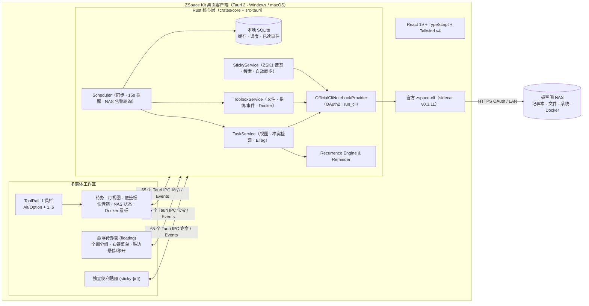

# ZSpace Kit（极空工具箱）产品与技术设计（v0.6）

> 状态：**v0.6.0 已实现并发布**（Windows / macOS 双端）。
> 变更记录：
> - v0.1：初始设计（FastAPI 服务端 + `zspace_skill` + 多端）。
> - v0.2：采用官方 `zspace-nas-agent-toolkit`（`zspace-cli` v0.3.11）OAuth2 授权与 `file notes` 契约；简化为**纯桌面客户端架构（Tauri 2 + 内置 `zspace-cli`）**，开机自启常驻托盘，零服务端部署；时间模型简化为**截止日期 + 截止时间 + 全天**。
> - v0.3：定位由单一 Todo 扩展为**极空工具箱（ZSpace Kit）**：加入模块化主工作台（ToolRail + `TOOLBOX_MODULES`）、月视图（农历/节假日/拖拽/右键快建）、云便签与桌面便利贴（`ZSpace Sticky` / `ZSK1`）、文件快传箱、NAS 状态看板与告警桥接、Docker 容器看板；并用 **OS 系统原生通知**全面替代应用内通知中心。
> - v0.4：桌面体验打磨、Z4 遥测适配、快传箱锁定与真应用内更新：Windows Toast AUMID 自动注册、`detail.list` 遥测解析与日志/JSON 复制、窗口几何与贴边记忆持久化、托盘动态计数与直达、2 MiB 脱敏滚动日志、文件快传箱严格锁定 `我的文件/downloads`，以及流式下载 + SHA-256 校验 + Windows `ShellExecuteW` `/P /UPDATE /R` 应用内更新。
> - v0.5：LAN 内网直连模式（`--mode` / `--host` / `--clear-host`）、`zspace-cli doctor` 连接诊断、文件快传箱文件夹递归上传（实时进度 + 现有目录复用）、统一上传/下载队列与重试、批量下载与分页加载。
> - v0.6：中国法定工作日/调休重复（`cn_workday`）、离线 1901–2099 中国农历重复引擎（`calendar: "lunar"` + 闰月策略）、单次发生实例改期/恢复 UI（新增 `clear_occurrence_override`，共 65 个 IPC 命令）。

本项目的核心技术支柱有三项（外加 v0.3 引入的可扩展工具箱集成层）：

1. **原生笔记兼容性**：结构化数据写入普通 HTML 笔记，官方记事本可正常浏览、修改备注且不丢失提醒、重复规则或便签样式。
2. **重复任务引擎**：区分「系列」与「发生实例」，一个系列仅对应一条原生笔记并保留完成历史。
3. **本地常驻提醒与告警桥接调度**：开机自启、常驻托盘，电脑运行期间按时弹出 Windows/macOS 原生通知，关机错过的提醒在开机后自动补发；同时将新到达的 NAS 系统告警桥接至桌面通知。
4. **统一工具箱适配层（`ToolboxService`）**：基于官方 `zspace-cli` 统一封装文件上传/下载/搜索、系统/磁盘/事件状态、Docker 容器控制与日志。

---

## 0. 已确认的架构决策

| # | 决策 |
|---|---|
| D1 | 一条普通任务对应一条原生笔记；一个重复**系列**也只对应一条原生笔记，实例历史记录在 `ZSM1` 元数据中 |
| D2 | 独立记事本 `location="2"`：待办使用 `ZSpace Memo` 分类（`<p>ZSM1:{...}</p>`），云便签使用 `ZSpace Sticky` 分类（`<p>ZSK1:{...}</p>`），均按分类 ID 识别 |
| D3 | **纯桌面客户端**：Tauri 2（Windows + macOS）内置官方 `zspace-cli` v0.3.11 sidecar，零服务端部署，不依赖 NAS 端运行 Docker 伴侣 |
| D4 | **官方 OAuth2 登录**：全程不接触、不存储 NAS 账号密码；由 `zspace-cli` 管理凭据并自动刷新（保留 `identifier="com.garyhj.zspacememo"` 确保跨版本配置与授权无缝延续） |
| D5 | 笔记正文均采用「人类可读 HTML + 底部结构化数据块」，不依赖 HTML 注释、隐藏标签或自定义属性 |
| D6 | **可扩展工具箱壳架构**：左侧 ToolRail 通过 `TOOLBOX_MODULES`（`Alt + 1 ~ 6` / macOS `Option + 1 ~ 6`）统一切换 6 个核心工作区（待办 / 月视图 / 便签 / 快传箱 / NAS / Docker） |
| D7 | **三类桌面窗口**：完整主窗口（ToolRail + 工作区）· 置顶悬浮待办窗（`/?mode=floating`，按已逾期/今天/本周/以后/无日期全量分组 + 贴边悬停/点击展开）· 独立桌面便利贴窗（`/?mode=sticky&id={id}`） |
| D8 | **时间模型精简**：不支持开始时间和时间段，只保留**截止日期 + 截止时间**（以及全天开关） |
| D9 | **OS 原生通知替代应用内通知中心**：直接触发 Windows / macOS 原生系统通知（含提示音开关与权限检测），关闭重启后自动补发遗漏提醒；新增 `bridge_nas_events` 开关同步弹出新 NAS 告警 |
| D10 | 本地辅助 SQLite（`LocalStorage`）只存配置、提醒作业、**可重建的笔记/便签索引缓存**及 `nas_seen_events` 去重记录，任务/便签唯一事实来源仍在极空间 NAS |
| D11 | **单实例与交互细节**：使用 `tauri-plugin-single-instance` 防止多开；全局屏蔽非输入区/非选区浏览器原生右键菜单；暂不引入深色模式（专注浅色高对比日间可读性） |

---

## 1. 整体架构



> [!NOTE]
> 核心域逻辑（Codec、重复引擎、提醒计算、`StickyService`、`ToolboxService`、`NotebookProvider` trait）集中在零 GUI 依赖的 `crates/core` 中，可独立通过 `cargo test -p zspace-memo-core` 验证。

---

## 2. 核心概念与数据模型

### 2.1 Task 与原生笔记（`ZSM1`）

- **Task（任务）**：一条原生笔记（`location="2"`，默认分类 `ZSpace Memo`），`id` 为原生笔记 ID。分单次任务（`repeat=null`）和重复系列（`repeat!=null`）。
- **Schedule**：仅含 `due: { date, time }`、`all_day`、`timezone`（IANA 时区）。无 `due` 的未完成单次任务归入「收集箱」。
- **Reminder**：与截止独立，支持多条相对/绝对提醒；全天任务默认触发时刻可配置（默认 `09:00`）。
- **Series（重复实例状态）**：保留当前游标 `cursor`、`overrides`（单实例覆盖）、最多 200 条倒序 `history` 及超限后的 `history_summary`。
- **正文三段结构（M0 真机验证定稿）**：

```html
<h1>续费 eSIM</h1>
<p>📅 截止 2026-11-26 周四 18:00</p>
<p>🔁 每 6 个月 · ⏰ 提前 1 天、提前 1 小时 · 优先级：普通 · 清单：个人</p>
<p>状态：待办 · 本次 2026-11-26 · 上次完成 2026-05-26</p>
<hr>
<p>记录充值金额、运营商和<a href="https://...">续费链接</a>。</p>
<hr>
<p>⚙ ZSpace Memo 数据（请勿手动修改）</p>
<p>ZSM1:{"v":1,"rev":7,"created_at":"2026-11-24T10:00:00+08:00","status":"active","priority":"normal","list":"个人","schedule":{...},"reminders":[...],"repeat":{...},"series":{...},"sum":"9f2c..."}</p>
```

> 写入后回读校验；解析与哈希计算前统一做 HTML 实体反转义；若元数据被官方编辑器破坏，按「本地 `last_valid_task_json` → 官方 `history_info`」顺序恢复并保留用户最新备注。

### 2.2 云便签数据模型（`ZSK1`）

云便签对应极空间独立记事本 `ZSpace Sticky` 分类下的原生笔记，格式与待办隔离：

```html
<h1>便签标题</h1>
<p>便签 Markdown 转 HTML 正文...</p>
<hr>
<p>⚙ ZSpace Kit 便签（请勿手动修改）</p>
<p>ZSK1:{"v":1,"rev":3,"color":"yellow","floating":true,"created_at":"2026-11-24T12:00:00+08:00"}</p>
```

- **色卡支持**：`yellow` / `blue` / `green` / `pink` / `purple` / `white`（6 种浅色便利贴视觉）。
- **独立悬浮便利贴窗**：当 `floating = true` 或用户点击「钉在桌面」时，Tauri 动态创建 label 为 `sticky-{id}` 的无边框置顶窗体（`/?mode=sticky&id={id}`）；主面板与浮窗间通过 `sticky:changed` 事件实时同步，编辑框停顿 **800ms 自动防抖保存**。

---

## 3. 重复规则与提醒调度

### 3.1 RepeatRule

支持 `daily | weekly | monthly | yearly` 频率、自定义 `interval`（如每 6 个月 = 半年）、`by_weekday`、`by_set_pos`（如每月第 1 个/最后一个周几）、`by_month_day`（含 `-1` 月末）、`by_month`、`cn_workday`（内置 `2001–2027` 国务院法定节假日与周末调休表，`lunar_tables.rs` + `lunar.rs`，2027 后回退 `mon_fri`）与 `mon_fri` 工作日过滤、公历（`gregorian`）/ 1901–2099 离线中国农历（`lunar`，支持每月/每年农历、闰月策略 `follow | both | only_leap` 与农历月末 `-1`）、`on_invalid_date`（`clamp | skip`）、`catch_up`（`latest | each`）、单次实例改期/恢复（`override_occurrence` / `clear_occurrence_override`）与终止条件（`never | until | count`）。编辑器内置实时预览接下来 5 次公历映射日期与中文规则描述（`describe_rule_zh` / `describeRepeatZh`）。

### 3.2 本地调度与系统原生通知（`scheduler.rs`）

- **同步周期**：应用启动时、窗口重新获得焦点（节流 `>=30s`）、以及后台可配置定时器（默认每 5 分钟）增量检查并计算未来 48 小时的 `reminder_jobs`。
- **触发流程**：每 15 秒扫描 `fire_at_utc <= now` 的作业；通过 `OfficialCliNotebookProvider` 复核笔记未完成且未删除后，调用 `tauri-plugin-notification` 弹出 Windows/macOS 原生通知。
- **NAS 告警通知桥接**：当设置中开启 `bridge_nas_events`（默认开启）时，后台轮询 `ToolboxService::poll_new_nas_notifications()`（`system events` `event_type="notify", is_new=1`）：
  - 首次启动若 `nas_seen_events` 表为空，仅将当前未读积压静默写入去重表（防止首次登录瞬间弹满屏历史消息）；
  - 后续每次轮询发现新 `event_id` 时触发 OS 原生通知并发送 `"nas:events-updated"` 前端刷新事件。

---

## 4. 工具箱模块详述

### 4.1 待办与月视图（`Tasks` & `MonthCalendarView`）
- **7 个待办视图**：收集箱、今天（可选置顶逾期）、即将到来、已逾期、全部、已完成、重复任务；支持按清单、标签筛选，以及清单模式 / 详情三栏模式。
- **月视图**：集成 `lunar-javascript` 显示农历日期、二十四节气、法定节假日与调休角标；按当前可见月份范围投射重复任务实例；支持拖拽改期、单日 `+N` 溢出浮层与**右键空白日期格内联快速新建任务**。

### 4.2 待办悬浮窄窗（`FloatingWindow`）
- 无边框置顶窄窗（默认约 `350×520`，快捷键 `Ctrl/Cmd + Shift + M` 随时呼出或隐藏）。
- 顶部显示「**待办**」并带有显式 `data-tauri-drag-region` 拖拽条；列表展示**全部活跃待办**并按 **已逾期 / 今天 / 本周 / 以后 / 无日期** 分组折叠；支持 `TaskContextMenu` 右键操作。
- 采用经典贴边自动隐藏交互：拖靠屏幕左/右/上边缘 20px 内自动收起为窄书签条；**鼠标指向即贴边滑出展开，离开窗体由 Rust 全局鼠标坐标监测自动折叠回书签；若需固定常驻，直接拖离边缘或点顶栏「移开固定」即可**。

### 4.3 文件快传箱（`FileDropView`）
- 底层调用 `zspace-cli` 的 `file space` / `file list` / `file mkdir` / `file upload` / `file download` / `search files`，上传与下载均保障至少 `300s` 超时防断。
- **严格锁定至「个人空间 / 我的文件/downloads」**：自动扫描个人空间定位（或按需创建）`/<pool>/my/data/downloads`，不提供目录选择器与子目录浏览跳转。
- 支持**拖拽或选择文件与文件夹**（自动按相对路径创建并智能复用现有子目录、过滤系统垃圾文件、实时推送单文件进度事件 `files:transfer-progress`）、统一上传/下载队列与失败一键重试、多选批量下载到本地目录以及列表分页加载。

### 4.4 NAS 状态看板与消息（`NasStatusView`）
- 并发聚合 `system info`（含 `include_polling: true` 实时指标，深度穿透 `detail.list[0]` / `polling` / `polling2` 等结构并兼容 Z4 `cpu.used` 比例与 `-1` 传感器占位数）、`storage info`（存储池 `pool_list` 与容量）与 `system disk`（磁盘健康与挂载状态）。
- 「原始数据」JSON 与日志区允许文本选中并配备一键复制按钮。
- 下方集成 `system events` 消息中心，默认聚焦「**通知**」分类（可选「日志 / 全部」），支持单条已读与全部已读（`--yes`）。

### 4.5 Docker 看板（`DockerBoardView`）
- 调用 `zspace-cli docker containers` 查询容器列表（`action=list`）与实时资源占用（`action=stats`）。
- 支持对容器执行 `start` / `stop` / `restart` 操作，以及弹窗查看并一键复制容器最近 100 行日志（`action=logs`）。

---

## 5. 开发里程碑与当前进度


