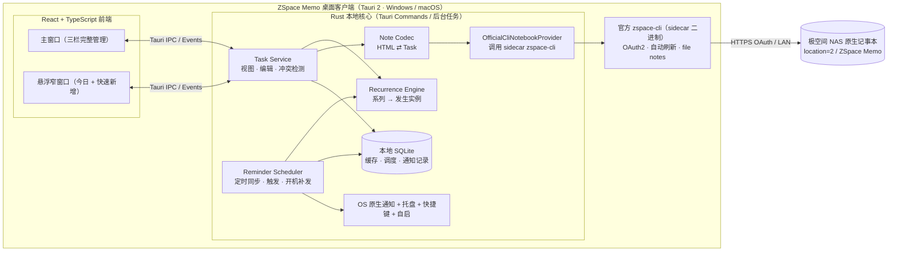
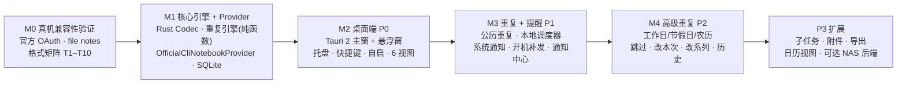

# ZSpace Memo 产品与技术设计（v0.2）

> 状态：**设计定稿中，即将进入 M0 真实 NAS 兼容性验证（尚未进入业务编码）**。
> 变更记录：
> - v0.1：初始设计（FastAPI 服务端 + `zspace_skill` + 多端）。
> - v0.2：采用官方 `zspace-nas-agent-toolkit`（`zspace-cli` v0.3.11）OAuth2 授权与 `file notes` 契约；简化为**纯桌面客户端架构（Tauri 2 + 内置 `zspace-cli`）**，开机自启常驻托盘，零服务端部署；时间模型简化为**截止日期 + 截止时间 + 全天**（去掉开始时间和时间段）。

本项目真正的难点有三个，本设计围绕它们展开：

1. **原生笔记兼容性**：结构化数据写进普通 HTML 笔记里，官方记事本能正常看、正常改，改完后不能丢失提醒和重复规则。
2. **重复任务引擎**：区分"系列"和"发生实例"，一个系列只对应一条笔记，并保留完成历史。
3. **本地常驻提醒调度**：开机自启、常驻托盘，电脑运行期间按时弹出 Windows/macOS 原生通知，关机错过的提醒在下次开机时自动补提醒。

---

## 0. 已确认的决策

| # | 决策 |
|---|---|
| D1 | 一条普通任务对应一条原生笔记；一个重复**系列**也只对应一条原生笔记，每次的发生实例记录在这条笔记里 |
| D2 | 独立记事本 `location="2"`；专用分类默认名为 `ZSpace Memo`（可在设置里改，程序按分类 ID 识别） |
| D3 | **纯桌面客户端（方案 B）**：Tauri 2（Windows + macOS）内置官方 `zspace-cli` 二进制，零服务端部署，不依赖 Docker |
| D4 | **官方 OAuth2 登录**：全程不接触、不存储 NAS 账号密码；由官方 `zspace-cli` 管理凭据并临期 60 秒自动刷新；默认走官方 `https://oauth.zconnect.cn`（可选配局域网直连） |
| D5 | 笔记正文分三段：**人类可读中文摘要** + **用户备注** + **结构化数据块**；不使用 HTML 注释、隐藏标签、自定义属性来存数据 |
| D6 | 元数据在官方记事本里显示中文，解析器中英文都认 |
| D7 | **两层窗口**：第一层为轻量悬浮窄窗口（今天/逾期 + 快速新增 + 勾选），第二层为完整三栏任务管理主窗口 |
| D8 | **时间模型精简**：不支持开始时间和时间段，只保留**截止日期 + 截止时间**（以及全天开关） |
| D9 | **提醒机制**：Tauri 本地常驻调度 + 开机自启 + 系统托盘；关机期间错过的提醒在下次开机同步后自动补发并进入应用内通知中心 |
| D10 | 本地辅助 SQLite 只存配置、提醒调度、投递记录和**可重建的索引缓存**，不存第二份任务数据 |

---

## 1. 整体架构



> [!NOTE]
> 所有核心业务（Codec、重复引擎、提醒调度、`NotebookProvider` trait）都在 Rust 核心层与桌面壳解耦。如果以后需要再加 NAS 服务端、手机 PWA 或 Homepage 嵌入，笔记里的 `ZSM1` 数据格式和 React 前端均可直接复用。

### 1.1 功能清单与优先级

| 模块 | 功能 | 优先级 |
|---|---|---|
| 登录与连接 | 应用内一键启动官方 OAuth2 授权、连接状态展示、注销/切换账号 | P0 |
| 任务基础 | 新增 / 编辑 / 删除 / 完成 / 重新打开；标题、备注（多行 + 链接 + 基础 Markdown） | P0 |
| 任务属性 | 优先级、清单（分类）、多标签、置顶 | P0 |
| 时间 | 截止日期、截止时间、全天任务 | P0 |
| 视图 | 收集箱、今天、即将到来、已逾期、全部、已完成；排序、搜索 | P0 |
| 桌面基础 | 主窗口、悬浮窄窗口（可置顶）、系统托盘/菜单栏、全局快捷键、关闭到托盘、开机自启 | P0 |
| 视图 | 重复任务视图 | P1 |
| 提醒 | 准时 / 提前 N / 自定义 / 多个提醒；本地常驻调度、Windows/macOS 系统通知、开机补提醒、应用内通知中心 | P1 |
| 重复 | 每天 / 每周（选星期几）/ 每月（日期、最后一天、第 N 个星期几）/ 每年 / 每 N 天·周·月（含每半年）；完成本次自动推进到下一次 | P1 |
| 重复 | 工作日（中国法定调休）、节假日、农历、跳过本次、修改本次、修改系列、终止系列、历史管理 | P2 |
| 扩展 | 子任务、附件（复用官方 `file notes` 附件接口）、导出 TXT/DOCX、日历视图、可选 NAS 后端/PWA | P3 |

---

## 2. 核心概念

| 概念 | 定义 |
|---|---|
| **Task（任务）** | 一条原生笔记，`id` 就是原生笔记 ID。分两种：**单次任务**（没有 `repeat`）和**重复系列**（有 `repeat`） |
| **Series（系列）** | 带重复规则的任务，定义了"模板"（标题、备注、截止时间、提醒、优先级）和规则 |
| **Occurrence（发生实例）** | 系列在某个日期的一次具体执行，用**原始日期** `occurrence_key = YYYY-MM-DD` 唯一标识 |
| **Schedule（时间安排）** | 截止日期、截止时间、全天、时区。和提醒、重复是相互独立的字段 |
| **Reminder（提醒规则）** | 相对截止时间提前多久，或一个绝对时间。一个任务可以有多个 |
| **Reminder Job（提醒作业）** | 调度器从规则计算出的触发计划，存在本地 SQLite 里，**可随时从笔记重建** |
| **List（清单 / 分类）** | 任务的业务分类，例如"工作""生活"，存在任务元数据里 |

---

## 3. 任务数据模型

### 3.1 Task

```jsonc
{
  "id": 12345,                       // 原生笔记 ID，不另造 ID
  "title": "续费 eSIM",               // = 原生 title
  "description": "记录充值金额、运营商和[续费链接](https://...)。", // Markdown 子集
  "status": "pending",               // 单次：pending | completed；系列：active | ended
  "priority": "normal",              // low | normal | high | urgent
  "list": "个人",                     // 清单 / 分类，可为空
  "labels": ["续费", "eSIM"],
  "pinned": false,                   // = 原生 pin_flag
  "schedule": { /* 3.2 */ },
  "reminders": [ /* 3.3 */ ],
  "repeat": null,                    // 或 RepeatRule（第 5 节）
  "series": null,                    // 重复任务的实例状态（3.4）
  "completed_at": null,              // 单次任务的完成时间
  "created_at": "2026-11-24T10:00:00+08:00",
  "updated_at": "2026-11-24T10:00:00+08:00",
  "source": "zspace_notebook",
  "meta_state": "ok",                // ok | missing | recovered | conflict
  "etag": "W/\"7-9f2c\""             // rev + 正文哈希，用于并发冲突检测
}
```

### 3.2 Schedule：截止日期、截止时间、全天

```jsonc
"schedule": {
  "all_day": false,
  "due": { "date": "2026-11-26", "time": "18:00" },   // 无日期时为 null
  "timezone": "Asia/Shanghai"                          // IANA 时区
}
```

- `date` 和 `time` 分开存；`all_day = true` 时 `time` 为 `null`。
- 没有 `due` 的未完成单次任务进入收集箱。
- 不支持开始时间和时间段（D8）。

### 3.3 Reminder：与截止独立，可设多个

```jsonc
"reminders": [
  { "id": "r1", "type": "relative", "offset_minutes": -1440 },                // 提前 1 天
  { "id": "r2", "type": "relative", "offset_minutes": -60 },                  // 提前 1 小时
  { "id": "r3", "type": "relative", "offset_days": -1, "day_time": "09:00" }, // 全天任务：前一天 09:00
  { "id": "r4", "type": "absolute", "at": "2026-11-25T18:00" }                // 仅用于单次任务
]
```

- 预设：不提醒 / 到期时 / 提前 5、10、15、30 分钟 / 1 小时 / 1 天 / 自定义。
- 全天任务的"到期时"等于当天 `day_time`（默认 09:00，可在设置中改）。
- 截止日期清空时，相对提醒标记为 `inactive` 并在 UI 提示，不静默删除。

### 3.4 Series（重复任务的实例状态）

```jsonc
"series": {
  "cursor": "2027-05-24",          // 当前待处理实例的原始日期
  "overrides": {                    // "修改本次"：仅对尚未处理的实例生效
    "2027-05-24": { "schedule": { "due": { "date": "2027-05-26", "time": "18:00" } } }
  },
  "history": [                      // 显式操作，倒序，最多保留 200 条
    { "key": "2026-11-24", "status": "completed", "at": "2026-11-24T20:13:00+08:00" },
    { "key": "2026-05-24", "status": "skipped",   "at": "2026-05-23T09:00:00+08:00" }
  ],
  "history_summary": { "completed": 0, "skipped": 0, "before": null },
  "ended_at": null
}
```

### 3.5 标签与清单

- **标签**：优先使用官方 `file notes` 的 `label` 操作（`label_id + label_action: 1/2`），【M0 验证】实测其返回和显示效果；若受限则退回存在数据块里。
- **清单（分类）**：存在任务元数据 `list` 字段里，所有任务统一归属 `ZSpace Memo` 单个原生分类，不建原生子分类。

---

## 4. 笔记正文存储格式（核心难点 1）

### 4.1 正文三段结构（暂定，最终编码由 M0 验证决定）

```html
<h1>续费 eSIM</h1>
<p>📅 截止 2026-11-26 周四 18:00</p>
<p>🔁 每 6 个月 · ⏰ 提前 1 天、提前 1 小时 · 优先级：普通 · 清单：个人</p>
<p>状态：待办 · 本次 2027-05-24 · 上次完成 2026-11-24</p>
<hr>
<p>记录充值金额、运营商和<a href="https://...">续费链接</a>。</p>
<hr>
<p>⚙ ZSpace Memo 数据（由 ZSpace Memo 自动维护，请勿手动修改）</p>
<pre>ZSM1:{"v":1,"rev":7,"status":"active","priority":"normal","list":"个人","schedule":{...},"reminders":[...],"repeat":{...},"series":{...},"sum":"9f2c..."}</pre>
```

- 第一行保留 `<h1>{title}</h1>`；摘要行紧跟其后，使官方列表 `in_brief` 展示关键日期/重复信息。
- 数据块放末尾，远离用户编辑备注的位置；编码按 M0 实测顺序择优：`<pre>` JSON → `<p>` JSON → `<p>` `ZSM1b:` base64url。
- 不依赖 HTML 注释、`data-*`、`class`、`style` 或隐藏标签。

### 4.2 【M0 验证】兼容性测试矩阵

使用官方 `zspace-cli file notes`（`location="2"`）在真实 NAS 上验证并记录到 `docs/COMPATIBILITY.md`：

| # | 验证项 |
|---|---|
| T1 | CLI 新建笔记 → 官方客户端（Web / 桌面 / 手机）打开查看显示效果与 `in_brief` |
| T2 | 官方客户端**只改备注**并保存 → CLI `info` 读回，检查数据块是否逐字节保留 |
| T3 | 官方客户端改标题 → `title` 与 `<h1>` 是否同步 |
| T4 | 官方客户端改摘要行 → 哈希检测与有限反向解析 |
| T5 | 官方客户端误删数据块 → 恢复流程验证 |
| T6 | 官方客户端在分类中新建普通笔记 → 识别为收集箱待办 |
| T7 | 大正文（约 200 条历史）是否被截断 |
| T8 | `list` 返回字段（`body`、更新时间、`pin`、`label`、`sortby`） |
| T9 | `history` / `history_info` 能否取回旧版本完整正文（用于恢复） |
| T10 | `label`（增删多标签）和 `trash`/`restore` 行为 |

### 4.3 双向编辑与防丢机制

- **写入后回读校验**：每次写入后立刻 `info` 回读，确认数据块可完整解析才视为成功。
- **元数据丢失自动恢复**：同步时若发现数据块缺失或损坏，按「本地 SQLite 缓存上一次有效元数据 → 官方 `file notes history` / `history_info`」顺序找回；**保留用户新改的标题和备注**，仅补回数据块写回 NAS，并通知用户已恢复。恢复前不取消已有提醒。
- **富文本保护**：若备注包含官方编辑器的复杂富文本（图片/表格/颜色），进入保护模式只读展示，修改其他字段时原样回写备注 HTML。

---

## 5. 重复规则引擎（核心难点 2）

### 5.1 RepeatRule

```jsonc
"repeat": {
  "freq": "monthly",              // daily | weekly | monthly | yearly
  "interval": 6,                  // 每 N 个周期；每半年 = monthly + 6
  "calendar": "gregorian",        // gregorian | lunar（P2）
  "by_weekday": null,             // weekly: ["MO","WE"]；monthly 可配 by_set_pos
  "by_set_pos": null,             // 1 = 第一个，-1 = 最后一个
  "by_month_day": [24],           // [-1] = 每月最后一天
  "by_month": null,               // yearly: [11]
  "lunar": null,                  // P2: { "month": 8, "day": 15, "leap": "follow" }
  "day_filter": null,             // P2: "cn_workday" | "cn_holiday" | "mon_fri"
  "festival": null,               // P2: { "name": "春节", "offset_days": 0 }
  "on_invalid_date": "clamp",     // clamp（默认，顺延到月末）| skip
  "basis": "schedule",            // schedule（按计划日期）| completion（按完成日期）
  "catch_up": "latest",           // latest（默认，跳到最近一期，过期算错过）| each（逐期补做）
  "end": { "type": "never" },     // never | until | count
  "dtstart": "2026-11-24"
}
```

### 5.2 实例生命周期与幂等操作

- 五种状态：`completed`、`skipped`、`missed`（推算，不存储）、`pending`（当前 `cursor`）、`future`（推算，不存储）。
- 支持：完成本次（P1）、撤销完成（P1）、跳过本次（P2）、修改本次（P2）、修改此次及以后（P2）、修改整个系列（P1/P2）、终止系列（P2）、删除系列（二次确认，走回收站 `trash`）。
- 所有实例操作以 `occurrence_key` 为幂等键，重复点击不会推进两次。
- 规则编辑器实时预览接下来 5 次发生日期。

---

## 6. 本地常驻提醒调度（核心难点 3）

### 6.1 工作方式

- 应用配置**开机自启**（`tauri-plugin-autostart`，默认开启，可在设置关闭）与**关闭窗口隐藏到托盘**。
- 后台循环（Tokio task）：
  - **同步**：启动时、每 5 分钟、本应用写入后立即同步一次（按 `sortby` 增量检查，降低请求量），计算未来 48 小时内的提醒时刻，写入本地 SQLite `reminder_jobs`。
  - **触发**：每 15 秒扫描 `fire_at_utc <= now` 的作业；触发前通过 `zspace-cli file notes info` 复核任务未被删除、未被完成、规则未改，再调用 `tauri-plugin-notification` 弹出系统通知，并写入应用内通知中心。
- **防重复**：确定性 `job_key = hash(task_id, occurrence_key, reminder_id, fire_at_utc)` 唯一约束 + 状态机 `pending → firing → sent/cancelled`。
- **关机错过补发**：每次启动（或从睡眠唤醒）时，扫描关机期间已过触发时刻但尚未完成的任务：
  - 自动在应用内通知中心列出，并弹出一条汇总/补提醒通知（例如「错过了 2 条提醒：续费 eSIM…」），不会静默漏掉。
- **稍后提醒**：支持「10 分钟后 / 1 小时后 / 明天」，存在本地 SQLite `snoozes` 表，不污染笔记正文。
- **时区与夏令时**：笔记存本地挂钟时间 + IANA 时区，每次同步按当前时区换算 UTC；不存在的本地时间顺延，歧义时间取首次出现。
- **离线降级**：网络/NAS 离线时保留本地缓存和已有提醒作业，进入只读模式（不清空缓存，按计划弹出已有提醒并标注「离线」）。

---

## 7. 视图定义与交互

### 7.1 7 个视图

| 视图 | 筛选条件 | 默认排序 |
|---|---|---|
| **收集箱** | 未完成、无截止日期、非重复 | 置顶 → 创建时间倒序 |
| **今天** | 未完成、截止日期为今天（已逾期以独立分组置顶显示） | 置顶 → 截止时间 → 优先级 |
| **即将到来** | 未完成、截止日期在 `(今天, 今天+7天]`（天数可配），按天分组 | 日期 → 时间 → 优先级 |
| **已逾期** | 未完成且已过截止时间/日期 | 截止时间升序 |
| **全部** | 全部未完成任务（可选包含已完成） | 日期 / 优先级 / 创建时间 |
| **已完成** | 已完成单次任务 + 重复系列已完成实例 + 已结束系列 | 完成时间倒序 |
| **重复任务** | 全部系列，展示规则、下一次日期、已完成次数 | 下一次日期 |

### 7.2 两层桌面窗口与交互原型

交互原型见 [`prototype/index.html`](prototype/index.html)（单文件可直接浏览器打开）。

- **第一层：悬浮窄窗口**（约 340×520，可置顶、全局快捷键呼出并自动聚焦输入框）：只展示今天/逾期精简列表、快速新增（支持自然语言如 `明天 18:00 续费 eSIM !高 #个人`）、一键勾选；点击任务唤起主窗口并定位到详情。
- **第二层：主窗口**：三栏布局（侧边栏视图/清单 · 任务列表 · 详情面板）。详情面板支持直接编辑标题、截止日期/时间、多提醒、重复规则、清单/标签、Markdown 备注、重复实例时间线，以及「极空间笔记预览」。
- **日期选择器**：单面板（快捷日期今天/明天/后天/下周一/清除 + 月历 + 全天开关 + 截止时间），预留农历/节气/休班位置（P2）。
- **冲突处理**：写入前复核正文哈希，若发现极空间官方 App 已修改，弹出冲突横幅（查看差异 / 使用我的修改 / 放弃我的修改）。

---

## 8. 里程碑



- **M0 验收门槛**：通过官方 `zspace-cli` 完成 T1–T10 验证，证明官方客户端编辑保存后数据块不丢失，输出 `docs/COMPATIBILITY.md` 后再进入 M1 编码。
